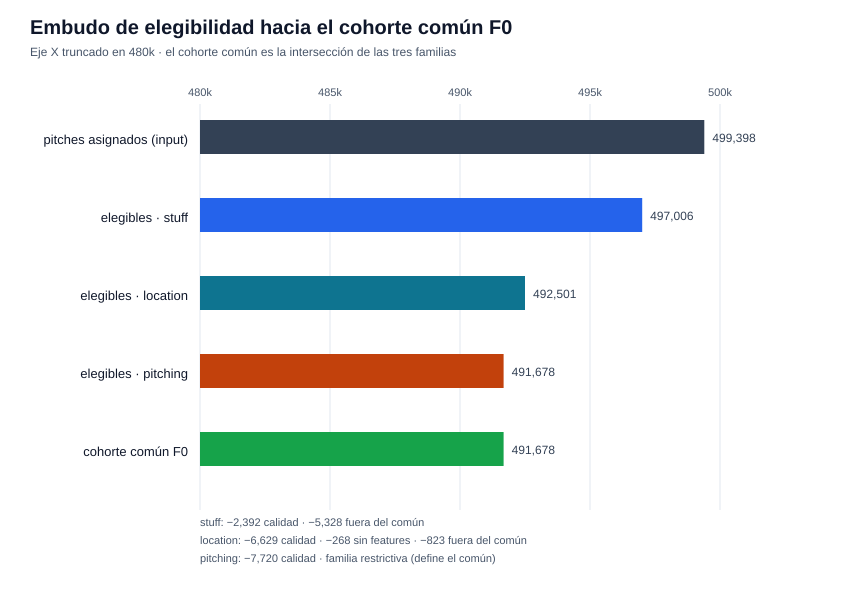
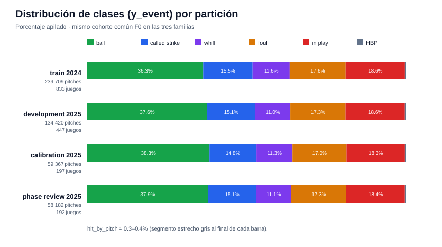
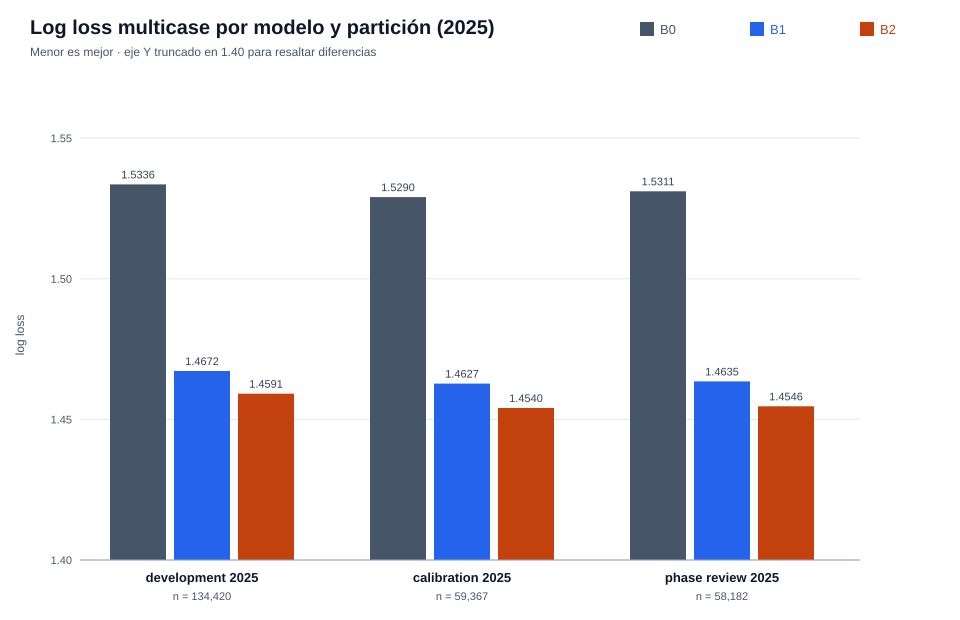
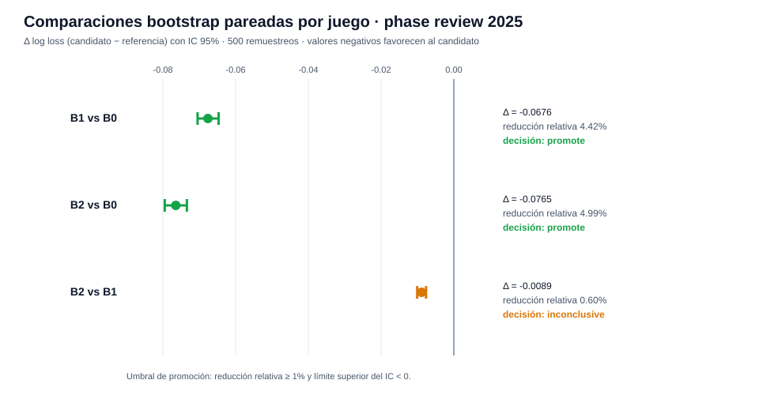
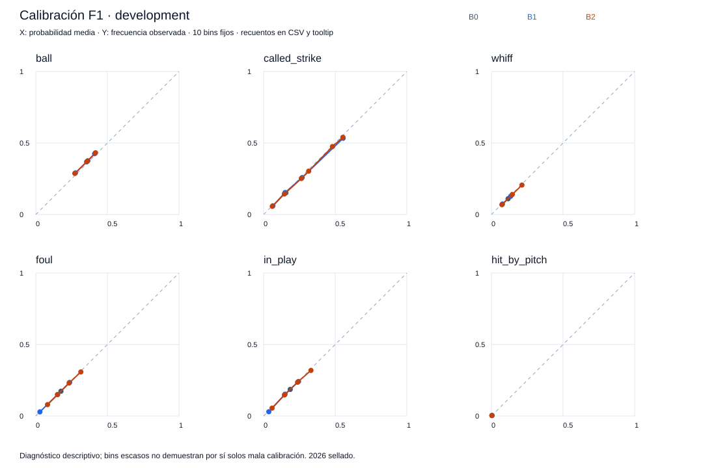
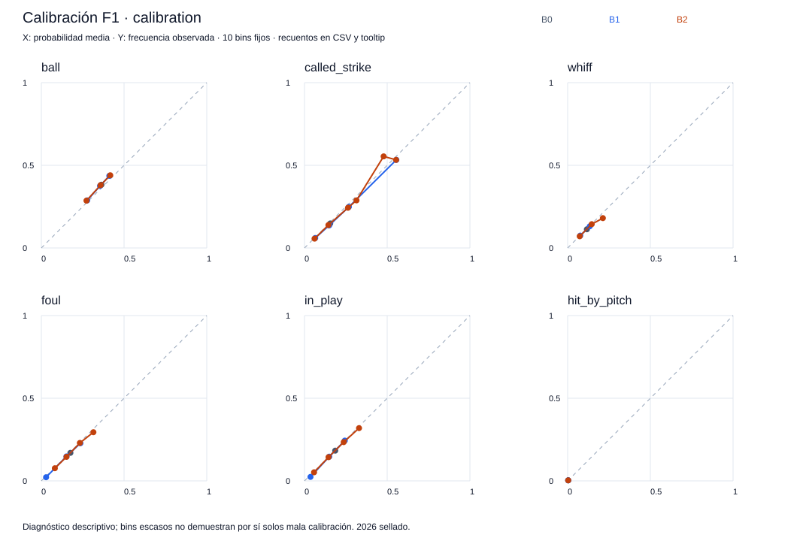
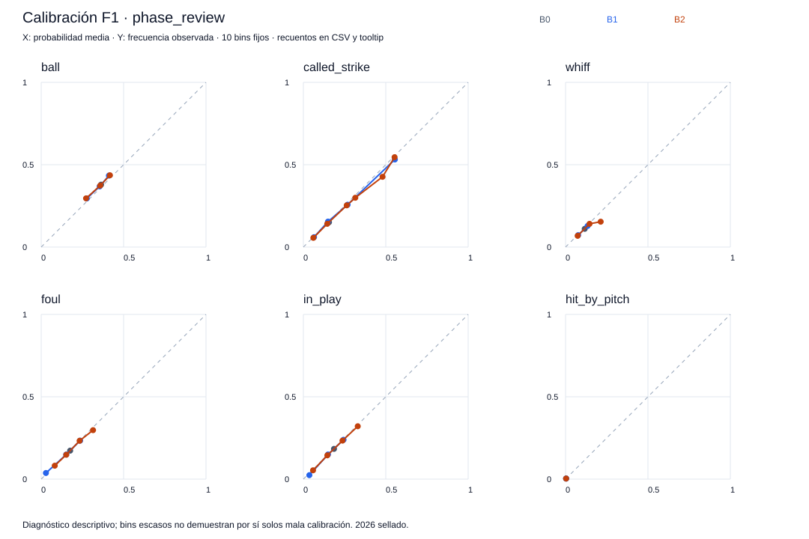

# Reporte de verificación — F0 y F1

Generado: 2026-10-10 · Experimentos: `f0-full-reproduction`, `f1-full-reproduction` · Protocolo A · Seed `20260929` · Data run `e9e0b1114dc68eb2`

## Resumen ejecutivo

| Fase | Estado | Resultado |
|------|--------|-----------|
| F0 — Infraestructura y cohorte | `verified` | 26/26 checks · cohorte común de **491,678 pitches** fijada por hash |
| F1 — Baselines evaluables | `verified` | 49/49 checks · decisión **`retain_reference`**: B1 sigue como referencia; B2 es comparador, no reemplazo |

Los tres baselines superan al baseline global B0 con evidencia estadística (bootstrap pareado por juego, IC 95%). B2 (conteo + tipo de pitch) es marginalmente mejor que B1 (solo conteo), pero la mejora relativa (0.60%) queda por debajo del umbral de promoción del 1% → **inconclusive**, no promueve.

**F2 queda habilitada** (modelo físico Stuff) tras las pruebas de regresión y reproducción. 2026 permanece sellado en todo momento.

---

## F0 — Adaptador y pruebas de infraestructura

**Qué se verificó:** el pipeline materializa un cohorte común (intersección de las familias `stuff`, `location`, `pitching`) con predicciones uniformes sintéticas — explícitamente *no* es un modelo entrenado ni evidencia de calidad predictiva. Las 26 pruebas de infraestructura pasaron: particionado por juego sin cruces, invarianza al shuffle, features exactas y 1:1 por familia, labels alineadas, rechazo de acceso a 2026 y a joins duplicados, roundtrip de predicciones.

La familia `pitching` es la restrictiva y define el cohorte común: 499,398 pitches asignados → **491,678** comunes (sha256 `655d826b…2780d92`).

| Partición | Pitches | Juegos | Uso |
|-----------|--------:|-------:|-----|
| train (2024) | 239,709 | 833 | fit de los baselines |
| development (2025) | 134,420 | 447 | desarrollo |
| calibration (2025) | 59,367 | 197 | calibración / referencia de scores |
| phase_review (2025) | 58,182 | 192 | revisión de fase (comparaciones) |

La distribución de clases (`y_event`) es estable entre particiones — buena señal para evaluación comparable.

---

## F1 — Baselines evaluables

**Modelos** (todos ajustados solo con `train` 2024, 239,709 pitches; pseudocount y prior fijos; sin tuning ni calibración):

- **B0** — distribución global por clase (sin features). Piso de comparación.
- **B1** — probabilidades por conteo `(balls, strikes)`. **Referencia conceptual de la fase.**
- **B2** — probabilidades por `(balls, strikes, auto_pitch_type)`, con fallback a B0 global en grupos fríos.

### Métricas 2025 (log loss multicase — menor es mejor)

| Partición | B0 | B1 | B2 |
|-----------|-----:|-----:|-----:|
| development | 1.5336 | 1.4672 | 1.4591 |
| calibration | 1.5290 | 1.4627 | 1.4540 |
| phase_review | 1.5311 | 1.4635 | **1.4546** |

Brier (suma sobre clases) muestra el mismo ordenamiento en las tres particiones. Fallback de B2: 187 / 41 / 109 filas (dev / cal / review) — fracción negligible resuelta al fallback declarado.

### Comparaciones bootstrap (phase_review, 500 remuestreos pareados por juego, IC 95%)

| Comparación | Δ log loss | IC 95% | Reducción rel. | Decisión |
|-------------|-----------:|--------|---------------:|----------|
| B1 vs B0 | −0.0676 | [−0.0705, −0.0647] | 4.42% | **promote** |
| B2 vs B0 | −0.0765 | [−0.0795, −0.0734] | 4.99% | **promote** |
| B2 vs B1 | −0.0089 | [−0.0101, −0.0076] | 0.60% | **inconclusive** |

**Lectura:** B1 y B2 superan a B0 con holgura (ICs completamente bajo cero, reducción >4%). B2 vs B1 tiene IC bajo cero pero reducción relativa 0.60% < umbral del 1% → inconclusive por criterio del contrato. Decisión de fase: `retain_reference` — B1 queda como referencia, B2 como comparador adicional.

### Curvas de calibración (diagnósticas — no se ajustaron calibradores)

B0 concentra toda la masa en un bin por clase (probabilidades globales constantes); B1/B2 dispersan y siguen la diagonal razonablemente bien para ser baselines de tabla.

---

## Cómo verificar los resultados

1. **Checks**: `artifacts/modeling/<exp>/<FASE>/checks.json` — todos los flags en `true` (26 en F0, 49 en F1).
2. **Decisión**: `decision.md` en cada carpeta — resume estado y decisión de fase.
3. **Métricas**: `metrics.json` — métricas por modelo/partición con `ids_sha256` de las filas evaluadas; los hashes de partición deben coincidir con el `cohort_manifest.json` de F0 (mismo cohorte, no re-muestreado).
4. **Modelos**: `models/B{0,1,2}.json` — conteos ajustados solo con train 2024 (`fit_ids_sha256` = hash de la partición train).
5. **Trazabilidad**: `manifest.json` registra versiones, hashes de código, config y artefactos — cualquier byte distinto rompe la cadena.
6. **Reproducción**: re-ejecutar con un `--experiment-id` nuevo debe reproducir el mismo `common_ids_sha256` (`655d826b…`) y los mismos `ids_sha256` por partición.

## Advertencias del contrato

- **2026 permanece sellado** — `no_2026` y `test_access_rejected` en checks; la calidad de 2026 solo fue perfilada, nunca accedida para fit/eval.
- **La revisión 2025 no es un test final independiente** (`review_is_independent_final_test: false`) — phase_review se usa para comparaciones de fase, no como evaluación de producción.
- Las curvas de calibración son **diagnósticas** — no se ajustaron calibradores ni hiperparámetros con datos 2025.
- No se ha calculado xRunValue ni scores; el target evaluado es `y_event`.

## Siguiente paso

F2 — modelo físico Stuff: **ya ejecutada y verificada** (`f2-full-check`, decisión `retain_reference`). Ver [REPORTE_F2.md](REPORTE_F2.md).

---
*Gráficas generadas por `scripts/generar_reporte_f0_f1.py` a partir de los artefactos verificados.*
