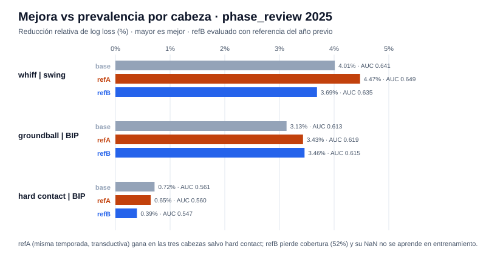
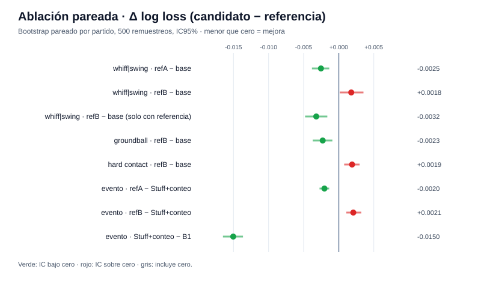
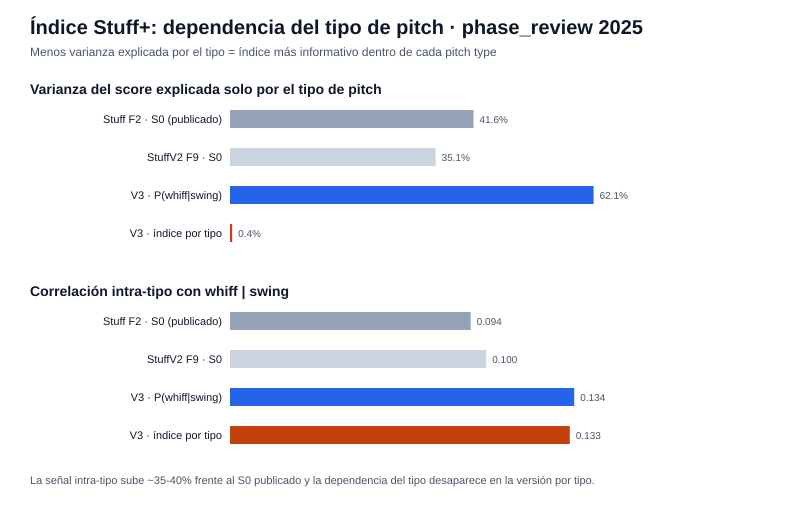

# Reporte de verificación — F10 (Stuff v3: features relativas al arsenal, post-release)

Generado: 2026-10-15 · Experimento: `f10-stuff-v3` · Protocolo A · Seed `20260929` · Data run `e9e0b1114dc68eb2` · Referencias: F1 `f1-full-reproduction`, F2 `f2-full-check`, F9 `f9-stuff-v2`, release `f8-release-20261014` · **Desarrollo posterior a la exposición del test 2026**

## Resumen ejecutivo

| Verificación | Resultado |
|--------------|-----------|
| Estado de fase | `verified` — todos los checks internos en `true` |
| Verificación independiente (`check_phase10.py`) | `verified` — 12 modelos recargados y re-predichos, 21 comparaciones bootstrap re-ejecutadas, referencias reconstruidas desde los datos, escalas del índice recalculadas |
| Test 2026 | **No consultado** — `test_accessed: false`; exposición de F8 declarada |
| Release F8 | Intacto — `check_phase8.py` sigue en `verified` |
| Decisión (regla predeclarada) | **`refA_diagnostic_only`** — la mejora existe con la referencia de la misma temporada, pero no con la referencia del año previo (desplegable); se conserva Stuff base |

**Lectura central:** F9 concluyó que la señal física estaba agotada; F10 muestra que no del todo. Con el **target propio de Stuff** (`whiff | swing`) y features relativas a la recta del propio pitcher, el AUC sube de 0.641 a 0.649 y el log loss mejora con IC bajo cero. Pero la ganancia es pequeña (+0.48% relativo sobre Stuff base) y **solo aparece cuando la referencia sale de la misma temporada** (transductiva). Con la referencia del año previo, el único modo desplegable hoy, el modelo completo **empeora** levemente porque ~48% de los pitches no tiene historia y esos casos nunca se vieron en entrenamiento.

Hallazgos que sí se sostienen:

1. **El criterio de F9 estaba mal planteado.** Vencer a B1 con física sola es imposible; lo correcto es medir el valor físico *incremental*. **Stuff+conteo supera a B1 en −0.0150 de log loss (−1.03% relativo, IC [−0.0165, −0.0137])**: la física sí aporta sobre el conteo.
2. **Stuff tiene señal real en sus targets propios:** whiff|swing −4.0% y groundball|BIP −3.1% frente a prevalencia, ambos con IC bajo cero. Hard contact casi no tiene señal física (−0.7%).
3. **El índice Stuff+ se puede mejorar:** `P(whiff|swing)` por tipo elimina la dependencia del tipo de pitch (de 42% de varianza explicada a 0.4%) y su correlación intra-tipo con whiff|swing sube de 0.094 a 0.133 (+41%).

---

## Qué se evaluó

| Variante | Matriz | Referencia del pitcher |
|----------|--------|------------------------|
| `base` | 11 físicas (F2) | ninguna |
| `refA` | base + Δvelo, ΔIVB, ΔHB, distancia de release a su recta | misma temporada, solo covariables físicas (**transductiva**, cobertura ~97.7%) |
| `refB` | igual que refA | entrenamiento: 2024; evaluación 2025: **año previo 2024** (cobertura 52.3%) |

Referencia = Four-Seam/Sinker más frecuente con ≥30 lanzamientos por pitcher-año; nunca lee outcomes. Ajuste en 2024, selección en development 2025 (3 configuraciones por modelo), comparaciones en phase_review 2025 (500 remuestreos por partido). Cohorte idéntica a F2 (`common_ids_sha256` verificado).

## Cabezas propias de Stuff (phase_review)

| Cabeza | n | Prevalencia | base | refA | refB |
|--------|--:|------------:|-----:|-----:|-----:|
| whiff \| swing (log loss) | 27,172 | 0.5474 | 0.5254 | **0.5229** | 0.5272 |
| whiff \| swing (AUC) | | 0.500 | 0.641 | **0.649** | 0.635 |
| groundball \| BIP (log loss) | 10,446 | 0.6950 | 0.6732 | 0.6711 | **0.6710** |
| hard contact \| BIP (log loss) | 10,346 | 0.5905 | **0.5862** | 0.5866 | 0.5881 |



Frente a prevalencia, whiff|swing y groundball|BIP cumplen la regla estándar (≥1% e IC95% bajo cero) con las tres variantes. Hard contact queda `inconclusive` (<1%).

## Ablación pareada: ¿ayudan las features relativas?

| Comparación | Δ log loss | IC95% | Rel. |
|-------------|-----------:|-------|-----:|
| whiff: refA − base | −0.00253 | [−0.00382, −0.00135] | +0.48% |
| whiff: refB − base | +0.00179 | [+0.00015, +0.00352] | −0.34% |
| whiff: refB − base, solo pitches con referencia | −0.00320 | [−0.00479, −0.00162] | +0.61% |
| groundball: refB − base | −0.00228 | [−0.00370, −0.00091] | +0.34% |
| hard contact: refB − base | +0.00191 | [+0.00078, +0.00298] | −0.33% |
| evento: refA − Stuff+conteo | −0.00204 | [−0.00274, −0.00136] | +0.14% |
| evento: refB − Stuff+conteo | +0.00208 | [+0.00109, +0.00322] | −0.14% |
| evento: Stuff+conteo − B1 | −0.01504 | [−0.01651, −0.01365] | **+1.03%** |



**Por qué refB pierde en conjunto:** donde sí hay referencia gana (−0.0032), pero entrenar con 97% de cobertura y evaluar con 52% deja sin aprender la rama de valores ausentes. No es falta de señal: es un desajuste de cobertura entre entrenamiento e inferencia, el mismo límite estructural que F5 encontró.

**Descriptivo post-hoc (no entra a la decisión):** una política de dos ramas — refB donde hay referencia, base donde no — da Δ whiff|swing −0.00169 (IC [−0.00255, −0.00077], +0.32%) y groundball −0.00142 (IC [−0.0024, −0.0006]), sin cambio en hard contact. Es la forma desplegable de capturar la ganancia, pero se definió después de ver los resultados: requiere una fase propia con regla predeclarada antes de adoptarse.

## Índice Stuff+ sin dominio del tipo de pitch

| Score (phase_review) | Varianza explicada por tipo | Corr. intra-tipo con whiff\|swing | Corr. global |
|----------------------|----------------------------:|----------------------------------:|-------------:|
| Stuff F2 · S0 (publicado) | 41.6% | 0.094 | 0.152 |
| StuffV2 F9 · S0 | 35.1% | 0.100 | 0.156 |
| V3 · P(whiff\|swing) | 62.1% | 0.134 | 0.208 |
| **V3 · índice por tipo** | **0.4%** | 0.133 | 0.127 |



El score crudo V3 mide más (corr. 0.208) pero depende más del tipo, porque los sliders y changeups dominan el whiff. La normalización **por tipo** (media y σ de calibration 2025, fallback global para tipos sin ≥200 pitches) lo vuelve comparable entre pitchers de tipos distintos sin perder la señal intra-tipo. Escala `100 + 10·z`, fija, provisional; no es valor de carreras. Se construyó con la variante `base` (la decisión no adopta refB).

## Cómo verificar

```bash
.venv/bin/python scripts/check_phase10.py f10-stuff-v3
.venv/bin/python -m unittest tests.modeling.test_stuff_v3 -v    # 12 pruebas
.venv/bin/python scripts/check_phase8.py artifacts/modeling/releases/f8-release-20261014
```

Evidencia: `artifacts/modeling/f10-stuff-v3/F10/` — `manifest.json`, `checks.json`, `selection.json`, `metrics.json`, `head_predictions.parquet`, `event_predictions.parquet`, `reference_profiles.parquet`, `reference_coverage.json`, `index_scales.json`, `index_diagnostics.json`, `stuff_v3_index.parquet`, `decision.md`. Guía: `docs/EJECUTAR_F10.md`.

## Qué implica

- **¿Se puede mejorar StuffV2?** Sí, pero poco y con matices: el techo es ~+0.5% relativo en whiff|swing con arsenal relativo. No cierra ninguna brecha de hackathon; la señal física es débil por naturaleza.
- **Lo más valioso no es el modelo sino el replanteamiento:** medir Stuff por sus targets (whiff|swing, groundball) y por su aporte incremental sobre el conteo, y publicar un índice normalizado por tipo.
- **Para el producto:** el release F8 no cambia. Una futura versión podría sustituir el S0 de Stuff por el índice por tipo de `P(whiff|swing)` (variante base, sin dependencia de historia) tras una fase con protocolo propio.

## Advertencias

- **Post-exposición**: 2026 ya fue abierto por F8; F10 no lo consultó. `phase_review` 2025 informó decisiones F2–F6 y no es un test independiente.
- **refA es transductiva**: usa covariables físicas del conjunto evaluado. Mide un techo, no es desplegable a pitchers nuevos.
- **La política de dos ramas es post-hoc**; se reporta, no se adopta.
- **Hard contact** carece de señal física útil (AUC ≈ 0.55).
- **Sin conclusiones causales ni valor de carreras**; los índices siguen siendo provisionales.

---
*Reportes: [F8](REPORTE_F8.md) · [F9](REPORTE_F9.md) · Gráficas generadas por `scripts/generar_reporte_f10.py`.*
