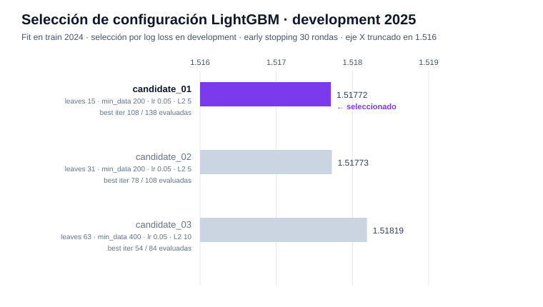
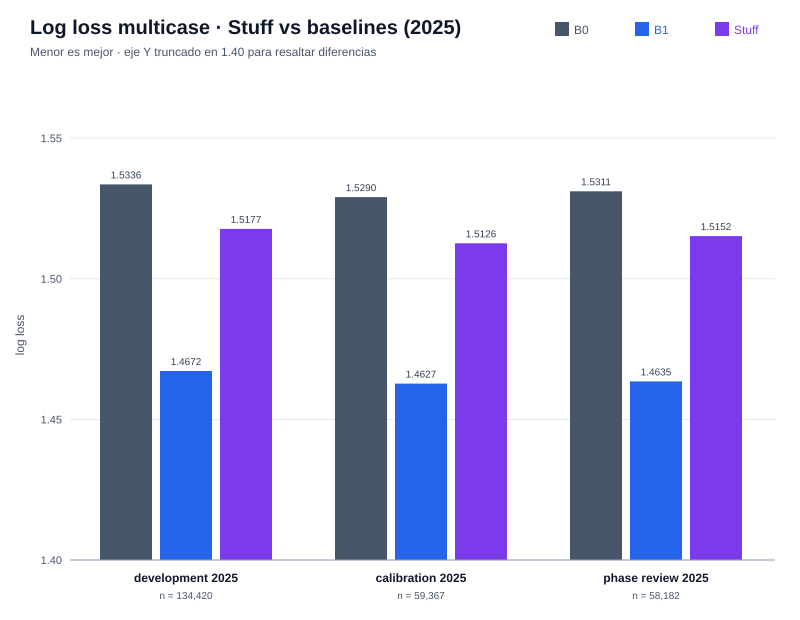
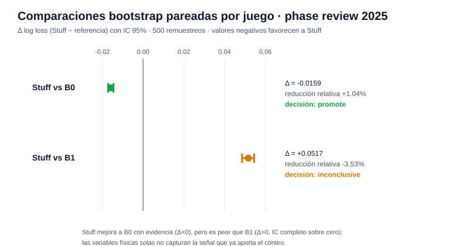
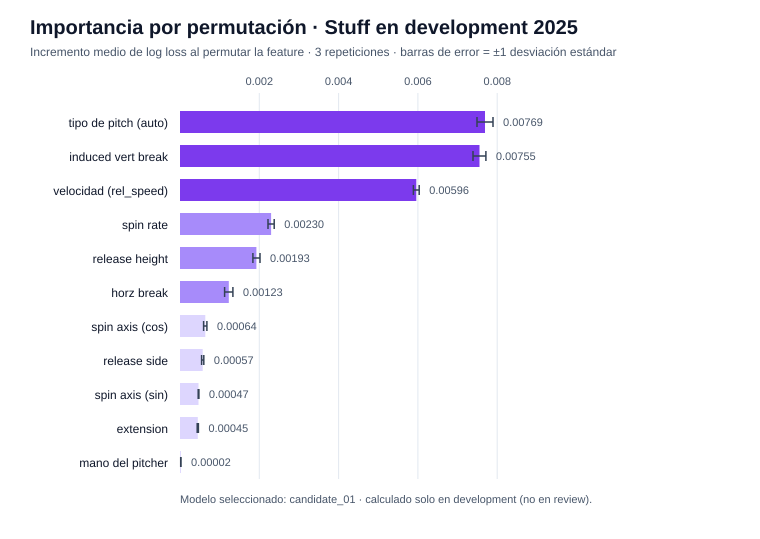
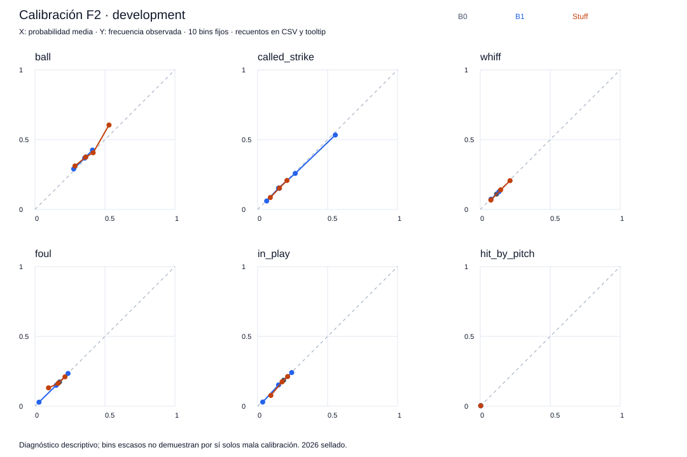
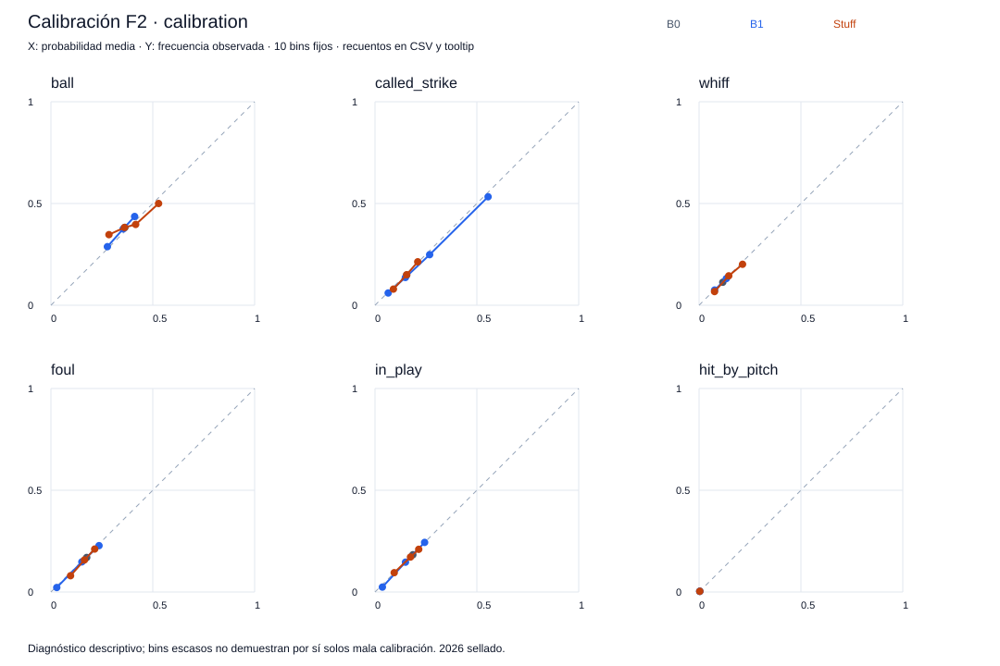
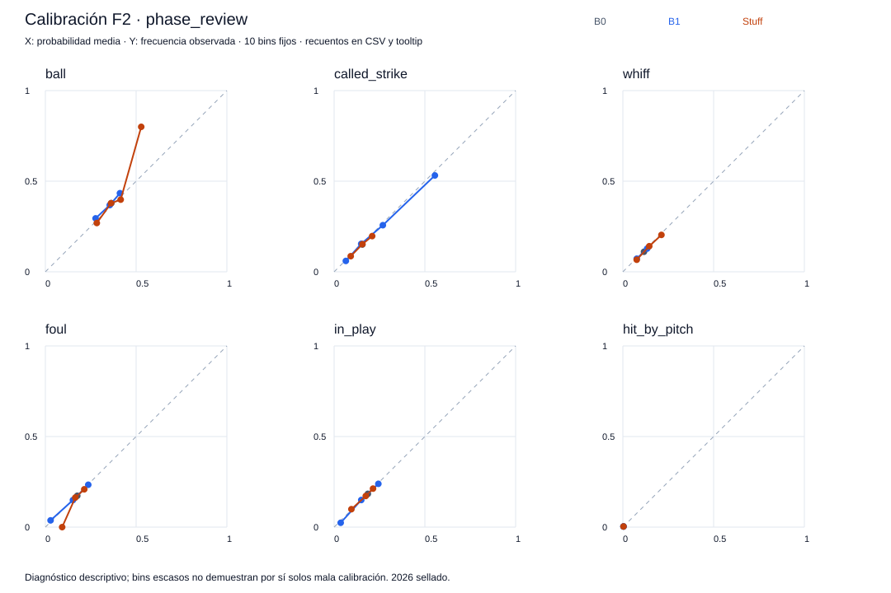

# Reporte de verificación — F2 (modelo físico Stuff)

Generado: 2026-10-10 · Experimento: `f2-full-check` · Protocolo A · Seed `20260929` · Data run `e9e0b1114dc68eb2` · Referencia F1: `f1-full-reproduction`

## Resumen ejecutivo

| Verificación | Resultado |
|--------------|-----------|
| Estado de fase | `verified` — 52/52 checks internos |
| Verificación independiente (`check_phase2.py`) | `verified` — recarga en proceso separado, 25 archivos verificados, 251,969 predicciones comparadas con diferencia máxima **0.0** |
| Decisión científica | **`retain_reference`** — B1 permanece como referencia; Stuff se conserva como candidato diagnóstico |

**Lectura central:** el modelo Stuff (LightGBM sobre variables físicas del pitch) supera al baseline global B0 con evidencia estadística (+1.04% de reducción relativa de log loss), pero es claramente **peor** que B1 (conteo `balls, strikes`): Δ = +0.0517 con IC 95% completo sobre cero. Las variables físicas *solas* no capturan la señal que ya aporta el conteo. Como advierte la decisión de fase: no superar un baseline contextual **no demuestra ausencia de valor** de las variables físicas — su valor incremental se evaluará al combinarlas con contexto en fases posteriores.

---

## Entrenamiento y selección

- **Backend:** LightGBM 4.6.0, clasificación multicase sobre `y_event` (6 clases).
- **Features físicas (11):** `auto_pitch_type`, `induced_vert_break`, `rel_speed`, `spin_rate`, `rel_height`, `horz_break`, `spin_axis_cos`, `spin_axis_sin`, `rel_side`, `extension`, `pitcher_throws`.
- **Fit:** solo train 2024 (239,709 pitches) · **selección/early stopping:** solo development 2025 · phase_review nunca se usó para seleccionar.
- **Cohorte:** idéntico al de F0/F1 (`common_ids_sha256 655d826b…`).

Los tres candidatos quedaron prácticamente empatados en development; ganó **candidate_01** (la configuración más simple: 15 hojas), con best_iteration 108 de 138 evaluadas.

| Candidato | Hiperparámetros | Dev log loss | Best iter |
|-----------|-----------------|-------------:|----------:|
| **candidate_01** ✓ | leaves 15 · min_data 200 · lr 0.05 · L2 5 | **1.51772** | 108 |
| candidate_02 | leaves 31 · min_data 200 · lr 0.05 · L2 5 | 1.51773 | 78 |
| candidate_03 | leaves 63 · min_data 400 · lr 0.05 · L2 10 | 1.51819 | 54 |

El modelo seleccionado se re-ajustó de forma determinista (`refit_same_configuration`) y la recarga reproduce las predicciones con diferencia absoluta máxima **0.0** (tolerancia 1e-8).

## Métricas 2025 (log loss multicase — menor es mejor)

| Partición | B0 | B1 | Stuff |
|-----------|-----:|-----:|------:|
| development | 1.5336 | 1.4672 | 1.5177 |
| calibration | 1.5290 | 1.4627 | 1.5126 |
| phase_review | 1.5311 | 1.4635 | **1.5152** |

Brier (suma sobre clases) muestra el mismo ordenamiento. Stuff se ubica entre B0 y B1 en las tres particiones.

## Comparaciones bootstrap (phase_review, 500 remuestreos pareados por juego, IC 95%)

| Comparación | Δ log loss | IC 95% | Reducción rel. | Decisión |
|-------------|-----------:|--------|---------------:|----------|
| Stuff vs B0 | −0.0159 | [−0.0172, −0.0146] | +1.04% | **promote** (apenas sobre el umbral del 1%) |
| Stuff vs B1 | +0.0517 | [+0.0486, +0.0545] | −3.53% | **inconclusive** (Stuff es peor) |

## Importancia de variables (permutación en development, 3 repeticiones)

El modelo se apoya principalmente en **tipo de pitch**, **induced vertical break** y **velocidad** — las tres con importancia claramente separada del resto. La mano del pitcher es prácticamente inerte en este feature set.

## Curvas de calibración (diagnósticas — no se ajustaron calibradores)

## Cómo verificar los resultados

1. **Checks**: `artifacts/modeling/f2-full-check/F2/checks.json` — 52 flags en `true`.
2. **Re-verificación independiente**: `.venv/bin/python scripts/check_phase2.py --experiment-id f2-full-check` → `status: verified`, `max_abs_prediction_difference: 0.0`.
3. **Selección**: `selection.json` — trials por candidato con `development_log_loss`, `best_iteration`; `review_used_for_selection: false`.
4. **Reproducibilidad**: `reproducibility.json` — `reload_max_abs_difference` y `refit_max_abs_difference` en 0.0 sobre 251,969 predicciones.
5. **Importancias**: `permutation_importance.csv` / `.json` — media y desviación por feature (3 repeticiones, solo development).
6. **Modelo nativo**: `stuff/model.txt` + `preprocessing.json` (vocabularios ajustados solo en 2024); `candidates/` conserva los 3 modelos de la búsqueda.

## Advertencias del contrato

- **2026 sigue sellado** — `test_accessed: false` en la verificación independiente.
- **phase_review no es un test final independiente** — se usa solo para comparaciones de fase.
- No hay scores, xRunValue ni calibradores ajustados todavía.
- El resultado "Stuff < B1" es sobre variables físicas *solas*; no descarta su valor incremental junto al contexto (objetivo de F3+).

## Siguiente paso

**F3 — Location y Pitching sin ambiente.** Habilitada tras las pruebas de regresión; no se inicia automáticamente.

---
*Reportes anteriores: [F0 + F1](REPORTE_F0_F1.md) · Gráficas generadas por `scripts/generar_reporte_f2.py`.*
