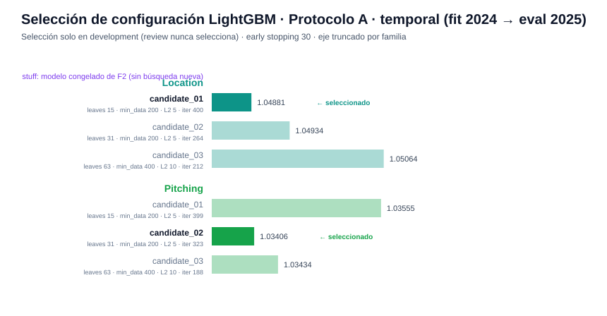
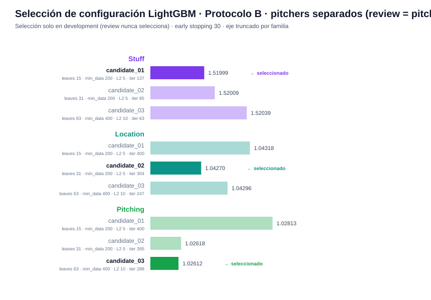
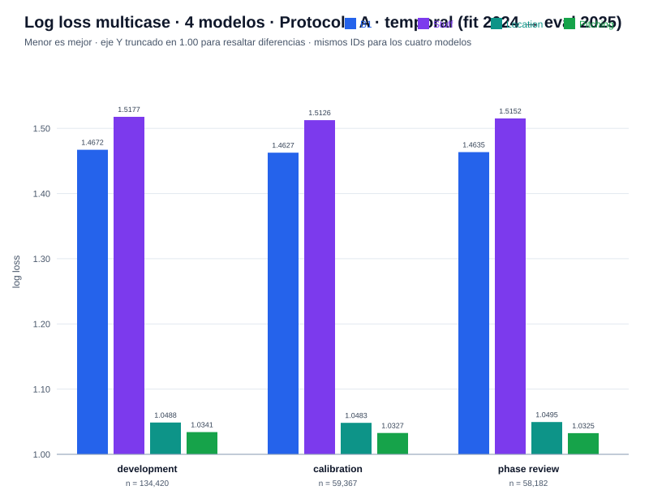
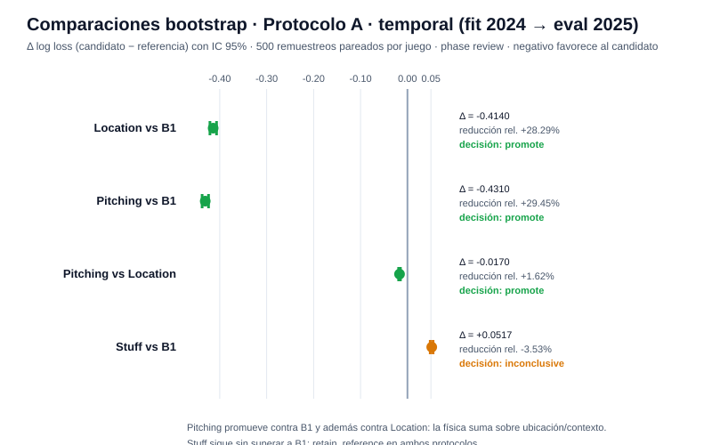
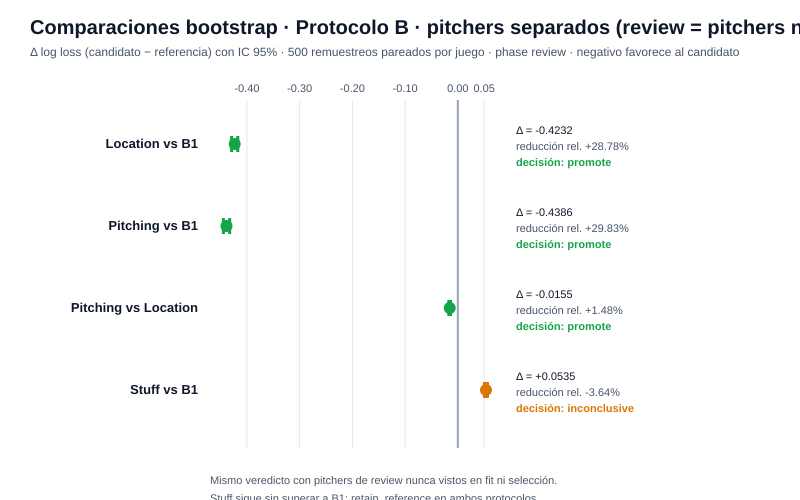
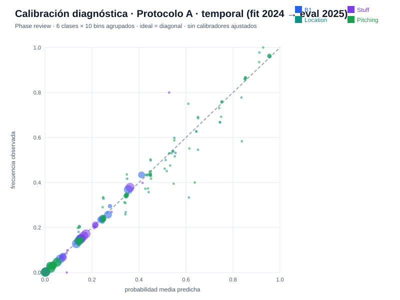
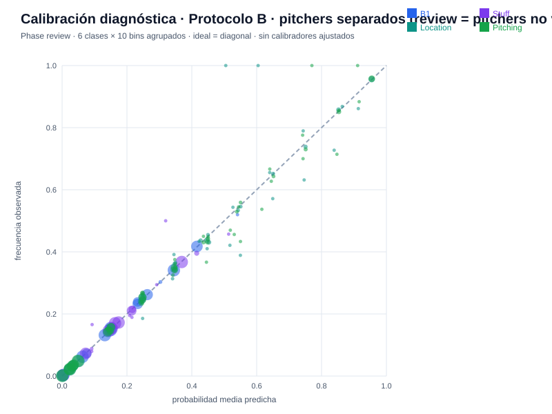

# Reporte de verificación — F3 (Location y Pitching sin ambiente)

Generado: 2026-10-10 · Experimento: `f3-full-check` · Protocolos A (temporal) y B (por pitcher) · Seed `20260929` · Data run `e9e0b1114dc68eb2` · Referencia F2: `f2-full-check`

## Resumen ejecutivo

| Verificación | Resultado |
|--------------|-----------|
| Estado de fase | `verified` — 69/69 checks internos |
| Verificación independiente (`check_phase3.py`) | `verified` — recarga en proceso separado, 67 archivos verificados; A: 1,007,876 predicciones comparadas (251,969 pitches × 4 modelos) y B: 526,572 (131,643 × 4), diferencia máxima **0.0**; 8 comparaciones bootstrap y 24 grupos de métricas reproducidos |
| Decisión científica | **`promote` en ambos protocolos** — Pitching es la nueva referencia predictiva; Stuff: `retain_reference` |

**Lectura central:** añadir ubicación y contexto (Location: `plate_loc_*`, conteo y lado del bateador) reduce el log loss ~28% frente a B1, y agregar encima la física del pitch (Pitching = unión de las 16 variables) aporta un incremento adicional de ~1.5–1.6% con el IC completo bajo cero. La conclusión se sostiene en el protocolo temporal (A) y con pitchers nunca vistos en ajuste ni selección (B). Queda respondida la pregunta abierta de F2: la física *sola* no superaba al conteo, pero sí **suma** sobre ubicación/contexto — `physical_increment_over_location: promote`.

---

## Familias y protocolos

| Familia | Variables | Rol en F3 |
|---------|-----------|-----------|
| B1 | conteo (`balls`, `strikes`) | baseline de referencia |
| Stuff (11) | física del pitch (`rel_speed`, `spin_rate`, `induced_vert_break`, `horz_break`, `extension`, `rel_*`, `spin_axis_*`, `auto_pitch_type`, `pitcher_throws`) | referencia física; congelado de F2 en A |
| Location (7) | `auto_pitch_type`, `pitcher_throws`, `plate_loc_height`, `plate_loc_side`, `balls`, `strikes`, `batter_side` | medir ubicación + contexto |
| Pitching (16) | unión Stuff ∪ Location, sin duplicados y sin altitud | medir el aporte físico sobre Location |

- **Protocolo A (temporal):** fit en train 2024; development/calibration/phase_review 2025 con las asignaciones originales. Reutiliza B1 y Stuff congelados de `f2-full-check`; solo Location y Pitching buscan configuración.
- **Protocolo B (por pitcher):** todo se reentrena — incluido B1 — solo con pitchers del grupo train (años 2024–2025). Development y calibration se toman de pitchers validation separados por partido; phase_review usa pitchers test **nunca vistos**. Los partidos pueden contener pitchers de grupos distintos, así que B no es un holdout por partido (1,313 juegos comparten fit y review); la separación es por pitcher.
- **Cohorte común:** los cuatro modelos se comparan sobre los mismos `pitch_uid` — la intersección de elegibilidad de las tres familias (491,678 pitches comparados en A). Las métricas comunes no representan la cobertura propia de cada familia.

| Partición (cohorte común) | A: pitches / juegos / pitchers | B: pitches / juegos / pitchers |
|---|---|---|
| train | 239,709 / 833 / 538 (2024) | 360,035 / 1,667 / 607 (2024–25) |
| development | 134,420 / 447 / 540 | 33,081 / 643 / 110 |
| calibration | 59,367 / 197 / 479 | 34,049 / 652 / 111 |
| phase_review | 58,182 / 192 / 492 | 64,513 / 1,313 / 104 |

## Entrenamiento y selección

- **Backend:** LightGBM 4.6.0, clasificación multicase sobre `y_event` (6 clases).
- **Selección:** 3 configuraciones predeclaradas por familia, hasta 400 rondas con early stopping de 30; seleccionan solo en development — `review_used_for_selection: false`.
- Los límites de rondas se mantuvieron aunque un candidato los alcanzara (location en A llegó a 400/400); no se amplió la búsqueda tras conocer la revisión.

**Protocolo A** — Stuff llega congelado de F2 (candidate_01, best iter 108):

| Familia | Candidato | Hiperparámetros | Dev log loss | Best iter |
|---------|-----------|-----------------|-------------:|----------:|
| location | **candidate_01** ✓ | leaves 15 · min_data 200 · L2 5 | **1.04881** | 400 |
| | candidate_02 | leaves 31 · min_data 200 · L2 5 | 1.04934 | 264 |
| | candidate_03 | leaves 63 · min_data 400 · L2 10 | 1.05064 | 212 |
| pitching | candidate_01 | leaves 15 · min_data 200 · L2 5 | 1.03555 | 399 |
| | **candidate_02** ✓ | leaves 31 · min_data 200 · L2 5 | **1.03406** | 323 |
| | candidate_03 | leaves 63 · min_data 400 · L2 10 | 1.03434 | 188 |

**Protocolo B** — las tres familias se reentrenan y seleccionan desde cero:

| Familia | Candidato | Hiperparámetros | Dev log loss | Best iter |
|---------|-----------|-----------------|-------------:|----------:|
| stuff | **candidate_01** ✓ | leaves 15 · min_data 200 · L2 5 | **1.51999** | 137 |
| | candidate_02 | leaves 31 · min_data 200 · L2 5 | 1.52009 | 85 |
| | candidate_03 | leaves 63 · min_data 400 · L2 10 | 1.52039 | 63 |
| location | candidate_01 | leaves 15 · min_data 200 · L2 5 | 1.04318 | 400 |
| | **candidate_02** ✓ | leaves 31 · min_data 200 · L2 5 | **1.04270** | 304 |
| | candidate_03 | leaves 63 · min_data 400 · L2 10 | 1.04296 | 247 |
| pitching | candidate_01 | leaves 15 · min_data 200 · L2 5 | 1.02813 | 400 |
| | candidate_02 | leaves 31 · min_data 200 · L2 5 | 1.02618 | 395 |
| | **candidate_03** ✓ | leaves 63 · min_data 400 · L2 10 | **1.02612** | 288 |

Los modelos seleccionados se re-ajustaron de forma determinista; la recarga y el refit reproducen las predicciones con diferencia absoluta máxima **0.0** (`reproducibility.json`).

## Métricas (log loss multicase — menor es mejor)

**Protocolo A** (2025, mismos IDs para los 4 modelos):

| Partición | B1 | Stuff | Location | Pitching |
|-----------|-----:|-----:|------:|------:|
| development | 1.4672 | 1.5177 | 1.0488 | 1.0341 |
| calibration | 1.4627 | 1.5126 | 1.0483 | 1.0327 |
| phase_review | 1.4635 | 1.5152 | 1.0495 | **1.0325** |

**Protocolo B** (pitchers separados, review = pitchers no vistos):

| Partición | B1 | Stuff | Location | Pitching |
|-----------|-----:|-----:|------:|------:|
| development | 1.4677 | 1.5200 | 1.0427 | 1.0261 |
| calibration | 1.4648 | 1.5224 | 1.0474 | 1.0298 |
| phase_review | 1.4706 | 1.5242 | 1.0474 | **1.0320** |

Brier (suma sobre clases) muestra el mismo ordenamiento en ambos protocolos: **Pitching < Location ≪ B1 < Stuff**. El salto de B1/Stuff a Location es de otro orden que las diferencias entre Location y Pitching.

## Comparaciones bootstrap (phase_review, 500 remuestreos pareados por juego, IC 95%)

**Protocolo A:**

| Comparación | Δ log loss | IC 95% | Reducción rel. | Decisión |
|-------------|-----------:|--------|---------------:|----------|
| Location vs B1 | −0.4140 | [−0.4209, −0.4068] | +28.29% | **promote** |
| Pitching vs B1 | −0.4310 | [−0.4376, −0.4238] | +29.45% | **promote** |
| Pitching vs Location | −0.0170 | [−0.0188, −0.0150] | +1.62% | **promote** |
| Stuff vs B1 | +0.0517 | [+0.0486, +0.0545] | −3.53% | inconclusive (peor) |

**Protocolo B:**

| Comparación | Δ log loss | IC 95% | Reducción rel. | Decisión |
|-------------|-----------:|--------|---------------:|----------|
| Location vs B1 | −0.4232 | [−0.4290, −0.4173] | +28.78% | **promote** |
| Pitching vs B1 | −0.4386 | [−0.4446, −0.4327] | +29.83% | **promote** |
| Pitching vs Location | −0.0155 | [−0.0171, −0.0139] | +1.48% | **promote** |
| Stuff vs B1 | +0.0535 | [+0.0506, +0.0563] | −3.64% | inconclusive (peor) |

Las cuatro comparaciones reproducen sus decisiones en A y B. Pitching cumple la doble exigencia del contrato (superar a B1 **y** a Location con reducción ≥1% e IC superior bajo cero) incluso generalizando a pitchers no vistos. Stuff confirma el veredicto de F2: no supera a B1 y se conserva como referencia/candidato, no como componente predictivo.

## Cobertura propia y cohorte común

Denominador: 499,398 lanzamientos 2024–2025 antes de filtros por familia.

| Familia | Elegibles propios | % del denominador | Cohorte comparada |
|---------|------------------:|------------------:|------------------:|
| Stuff | 497,006 | 99.52% | 491,678 |
| Location | 492,501 | 98.62% | 491,678 |
| Pitching | 491,678 | 98.45% | 491,678 |

Las banderas de calidad preparadas se conservaron; la elegibilidad de Pitching exige disponibilidad ambiental por el contrato de datos previo aunque la altitud no sea predictor.

## Curvas de calibración (diagnósticas — no se ajustaron calibradores)

## Cómo verificar los resultados

1. **Checks**: `artifacts/modeling/f3-full-check/F3/checks.json` — 69 flags en `true` (aislamiento de particiones, features exactos por familia, uniones uno a uno por `pitch_uid`, congelados de F2 en A, pitchers disjuntos en B).
2. **Re-verificación independiente**: `.venv/bin/python scripts/check_phase3.py --experiment-id f3-full-check` → `status: verified`, `max_abs_prediction_difference: 0.0` en ambos protocolos.
3. **Selección**: `A/selection.json` y `B/selection.json` — trials por familia con `development_log_loss`, `best_iteration`; `review_used_for_selection: false`.
4. **Reproducibilidad**: `A/reproducibility.json` y `B/reproducibility.json` — `reload` y `refit` en 0.0 sobre las 1,534,448 predicciones de ambos protocolos.
5. **Cohortes**: `cohort_manifest.json` (raíz y por protocolo) — recuentos y `ids_sha256` por partición; `coverage.json` separa cobertura propia de cohorte común.
6. **Modelos nativos**: `<protocolo>/{stuff,location,pitching}/model.txt` + `preprocessing.json`; `B1.json` por protocolo; `candidates/` conserva los modelos de la búsqueda.
7. **Decisión**: `F3/decision.md` y `metrics.json` (raíz) — `predictive_reference: Pitching`, `protocols_are_not_directly_comparable: true`.

## Advertencias del contrato

- **2026 sigue sellado** — `test_accessed: false` en la verificación independiente.
- **phase_review de A no es un test final independiente** — se usó en fases anteriores; B es prueba de generalización a pitchers no vistos, tampoco un test de 2026.
- **Los protocolos no son comparables entre sí** — particiones y poblaciones distintas; no se promedian métricas entre A y B.
- **Location no implica comando causal** — es asociación condicionada a dónde llegó el pitch y al contexto, no a dónde se pretendía lanzarlo.
- No hay scores, xRunValue, calibradores ni historia de arsenal todavía (entran en F4 y F5+).
- La validez de los IDs de pitchers entre temporadas sigue pendiente de confirmación de los organizadores.

## Siguiente paso

**F4 — Calibración por temperatura y cabezas de contacto** (contact/groundball/chase), solo sobre el protocolo A. Habilitada tras las pruebas de regresión; no se inicia automáticamente.

---
*Reportes anteriores: [F0 + F1](REPORTE_F0_F1.md) · [F2](REPORTE_F2.md) · Gráficas generadas por `scripts/generar_reporte_f3.py`.*
