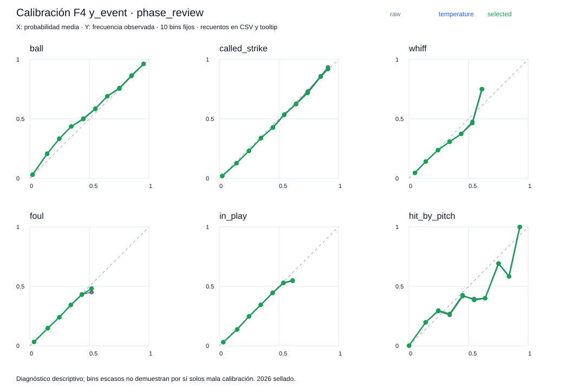
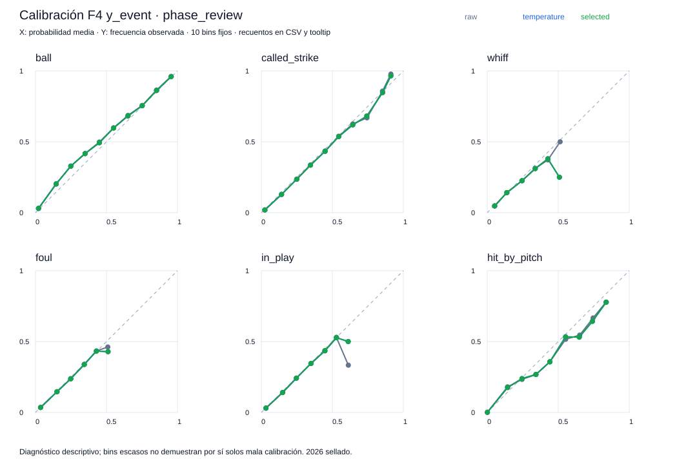
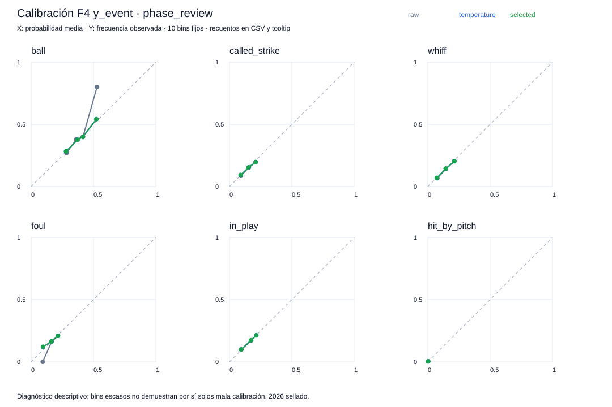
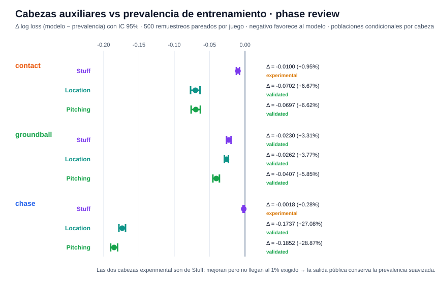
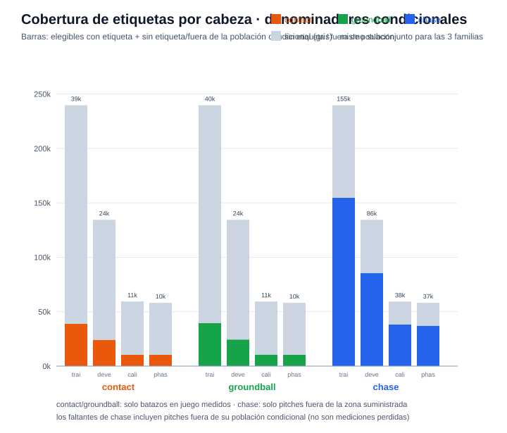
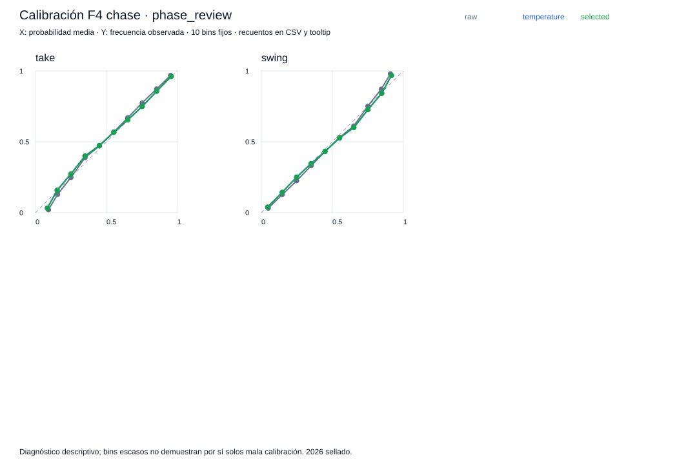

# Reporte de verificación — F4 (calibración por temperatura y cabezas de contacto)

Generado: 2026-10-10 · Experimento: `f4-full-check` · Protocolo A · Seed `20260929` · Data run `e9e0b1114dc68eb2` · Referencia F3: `f3-full-check`

## Resumen ejecutivo

| Verificación | Resultado |
|--------------|-----------|
| Estado de fase | `verified` — 84/84 checks internos |
| Verificación independiente (`check_phase4.py`) | `verified` — recarga en proceso separado, 169 archivos verificados, **755,907 filas públicas** de probabilidades (251,969 pitches × 3 familias), 135 grupos de métricas y 21 comparaciones bootstrap reproducidas; diferencia máxima **0.0**; temperaturas reajustadas solo con 2025/calibration |
| Decisión científica | **`promote`** — 7/9 combinaciones familia×cabeza `validated`; Pitching sigue como referencia predictiva de eventos |

**Lectura central:** F4 no cambia el ranking predictivo — agrega una temperatura escalar por familia (ajustada solo con calibration 2025 y aceptada solo por no empeorar la revisión) y tres cabezas auxiliares sobre subconjuntos condicionales. Las dos únicas cabezas que no promueven son las de **Stuff** (contact +0.95% — apenas bajo el umbral del 1% — y chase +0.28%): mismo patrón de F2–F3, la física sola no alcanza para resultados que dependen del contexto, mientras que combinada en Pitching produce la mayor ganancia de la fase (**chase +28.87%**).

---

## Qué se agregó en F4

- **Eventos congelados de F3** + temperatura escalar sobre log-probabilidades (softmax conserva que las seis clases sumen 1). Ajuste exclusivamente con `2025/calibration`; se conserva solo si `Δ log loss en revisión ≤ 0` — regla de no-empeoramiento, más estricta que el +0.5% máximo del contrato.
- **Tres cabezas auxiliares** por familia, cada una con su denominador condicional:

| Cabeza | Pregunta | Población condicional |
|--------|----------|----------------------|
| `contact` (3 clases) | weak <75 / medium 75–<95 / hard ≥95 mph | bola en juego **con velocidad medida** |
| `groundball` (binaria) | ¿rolado? | bola en juego **con tipo de batazo conocido** |
| `chase` (binaria) | take vs swing | pitch **fuera de la zona suministrada** |

- Referencia de cada cabeza: **prevalencia de entrenamiento** suavizada (pseudocount 1/clase). Promoción exige ≥1% de reducción relativa de log loss + IC 95% completo bajo cero. No promovida → `experimental`, salida pública = prevalencia suavizada; sin soporte (≥200 etiquetas, ≥20/clase) → `insufficient_data`, salida nula con motivo.
- Configuración auxiliar única predeclarada: leaves 15 · min_data 100 · lr 0.05 · L2 5 · hasta 200 rondas · early stopping 25 · selección solo en development.
- Las probabilidades públicas incluyen las condicionales (`p_weak_given_in_play`, `p_chase_given_outside`, …) y sus productos por pitch (`p_weak_per_pitch` = condicional × `p_in_play`), verificadas en [0,1] con débil+duro ≤ 1.

## Calibración de eventos (temperatura)

| Familia | Temperatura | Log loss revisión (original) | Con temperatura | Mejora rel. | Ruta |
|---------|------------:|-----------------------------:|----------------:|------------:|------|
| Stuff | 0.930 | 1.5152 | 1.5147 | +0.029% | temperature |
| Location | 0.991 | 1.0495 | 1.0494 | +0.007% | temperature |
| Pitching | 0.987 | 1.0325 | 1.0324 | +0.015% | temperature |

Las tres temperaturas quedan <1: los modelos estaban ligeramente **poco confiados** (probabilidades algo planas) y se afilan un poco. Las mejoras son pequeñas y las comparaciones bootstrap pareadas salen `inconclusive` — correcto: la temperatura no compite por promoción predictiva, solo se exige no empeorar. Aceptar una temperatura no promueve Stuff frente a B1 ni altera las decisiones de F3.

## Cabezas auxiliares vs prevalencia (phase_review, bootstrap 500 remuestreos pareados por juego)

| Familia | Cabeza | Log loss ref. | Log loss modelo | Δ | IC 95% | Reducción rel. | Estado / ruta pública |
|---------|--------|--------------:|----------------:|----:|-------|---------------:|----------------------|
| Stuff | contact | 1.0523 | 1.0424 | −0.0100 | [−0.0122, −0.0078] | +0.95% | experimental · prevalencia suavizada |
| Stuff | groundball | 0.6950 | 0.6720 | −0.0230 | [−0.0262, −0.0197] | +3.31% | **validated** · model |
| Stuff | chase | 0.6416 | 0.6398 | −0.0018 | [−0.0027, −0.0008] | +0.28% | experimental · prevalencia suavizada |
| Location | contact | 1.0523 | 0.9822 | −0.0702 | [−0.0770, −0.0636] | +6.67% | **validated** · model |
| Location | groundball | 0.6950 | 0.6688 | −0.0262 | [−0.0292, −0.0235] | +3.77% | **validated** · model |
| Location | chase | 0.6416 | 0.4679 | −0.1737 | [−0.1784, −0.1690] | +27.08% | **validated** · model |
| Pitching | contact | 1.0523 | 0.9827 | −0.0697 | [−0.0762, −0.0632] | +6.62% | **validated** · model |
| Pitching | groundball | 0.6950 | 0.6543 | −0.0407 | [−0.0455, −0.0362] | +5.85% | **validated** · model |
| Pitching | chase | 0.6416 | 0.4564 | −0.1852 | [−0.1901, −0.1803] | **+28.87%** | **validated** · model |

Sutilidad: las dos cabezas `experimental` de Stuff **sí mejoran** a la prevalencia con evidencia (IC completo bajo cero) — pero no llegan a la reducción mínima del 1% que exige la regla de promoción. El sistema conserva la prevalencia en la salida pública y guarda el candidato solo como diagnóstico.

## Cobertura de etiquetas condicionales

Las tres familias usan el mismo subconjunto común; recuentos no acumulables entre familias.

| Partición | Contacto medido | In-play sin velocidad | Groundball conocido | In-play sin tipo | Chase condicional |
|-----------|----------------:|----------------------:|--------------------:|-----------------:|------------------:|
| train | 38,977 | 5,555 | 39,520 | 5,012 | 154,819 |
| development | 24,207 | 794 | 24,454 | 547 | 85,571 |
| calibration | 10,525 | 342 | 10,622 | 245 | 38,366 |
| phase_review | 10,346 | 336 | 10,446 | 236 | 37,157 |

## Temperaturas y rondas auxiliares

| Familia/cabeza | Rondas elegidas | Temperatura | Aceptada |
|----------------|----------------:|------------:|----------|
| stuff/contact | 41 | 1.213 | temperature |
| stuff/groundball | 189 | 1.318 | temperature |
| stuff/chase | 111 | 0.915 | temperature |
| location/contact | 186 | 1.164 | temperature |
| location/groundball | 147 | 1.295 | temperature |
| location/chase | 200 | 0.928 | temperature |
| pitching/contact | 180 | 1.128 | temperature |
| pitching/groundball | 198 | 1.140 | temperature |
| pitching/chase | 200 | 0.908 | temperature |

Curva de calibración de la cabeza más ganadora (chase de Pitching, phase review — antes/después de temperatura):

## Cómo verificar los resultados

1. **Checks**: `artifacts/modeling/f4-full-check/F4/checks.json` — 84 flags en `true` (cohorte idéntica a F3, eventos congelados reproducen predicciones de F3, exclusividad weak/medium/hard, límites de productos condicionales, sin 2026 en salidas).
2. **Re-verificación independiente**: `.venv/bin/python scripts/check_phase4.py --experiment-id f4-full-check` → `status: verified`, `max_abs_prediction_difference: 0.0` en las 3 familias, `calibration_refit_only_2025_calibration: true`.
3. **Decisiones por cabeza**: `<familia>/<cabeza>/decision.json` — estado, comparación bootstrap y ruta pública.
4. **Temperaturas**: `event/temperature.json` + `calibration_policy.json` por familia (y por cabeza) — soporte de ajuste, comparación de revisión y ruta aceptada.
5. **Cobertura**: `<familia>/<cabeza>/coverage.json` — elegibles, faltantes y conteos por clase y partición.
6. **Salida pública**: `predictions.parquet` — 755,907 filas `(pitch_uid, family)` con columnas de eventos calibrados, condicionales, productos y `*_status/route` por cabeza.
7. **Reproducibilidad**: `<familia>/<cabeza>/reproducibility.json` — recarga y refit deterministas en 0.0.

## Advertencias del contrato

- **2026 sigue sellado** — `test_accessed: false`; `no_2026_output: true`.
- **La revisión se usa repetidamente** — elige temperatura/identidad y contrasta cabezas; no es un test final independiente.
- **Sesgo de selección en etiquetas**: los batazos sin velocidad o sin tipo medido no aportan evidencia — las métricas condicionales no demuestran rendimiento sobre batazos no medidos.
- **Los nulos de chase incluyen pitches fuera de su población condicional** — no son todos "mediciones perdidas".
- **Groundball es diagnóstico** — sin recompensa automática de carreras prevenidas; weak contact es proxy provisional.
- **Aceptar temperatura ≠ promoción predictiva** — usa la regla operativa de no empeoramiento.
- El protocolo B de F3 se conserva tal cual: F4 calibra solo con 2025/calibration del protocolo A.
- No hay scores, xRunValue, arsenal ni simulación ambiental todavía.

## Siguiente paso

**F5 — Arsenal con historia real.** Habilitada tras las pruebas de regresión; no se inicia automáticamente.

---
*Reportes anteriores: [F0 + F1](REPORTE_F0_F1.md) · [F2](REPORTE_F2.md) · [F3](REPORTE_F3.md) · Gráficas generadas por `scripts/generar_reporte_f4.py` (las curvas de calibración se copian de los artefactos).*
