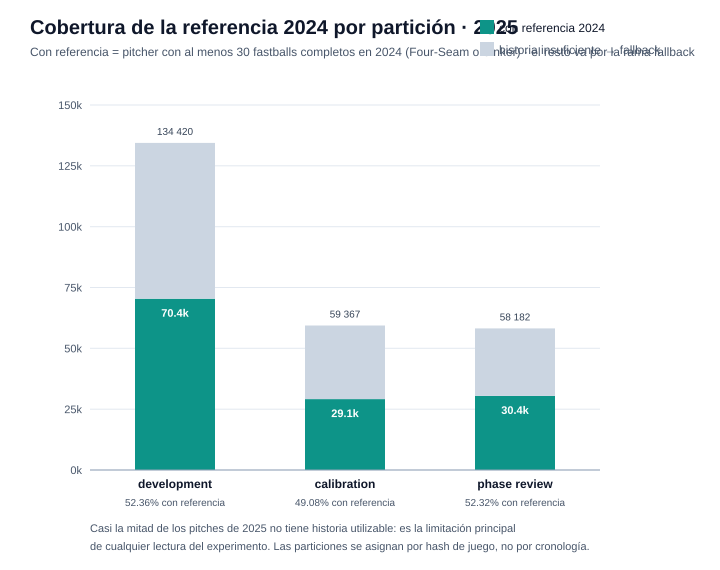
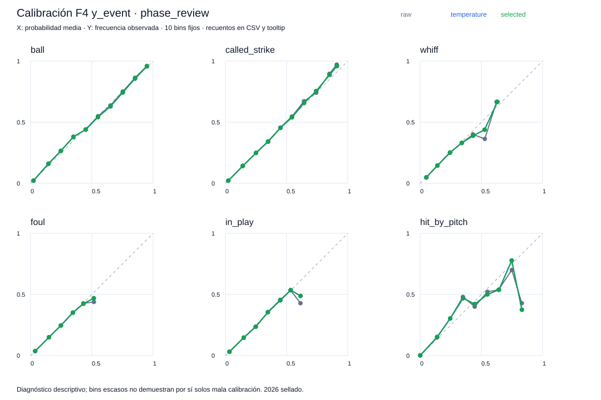
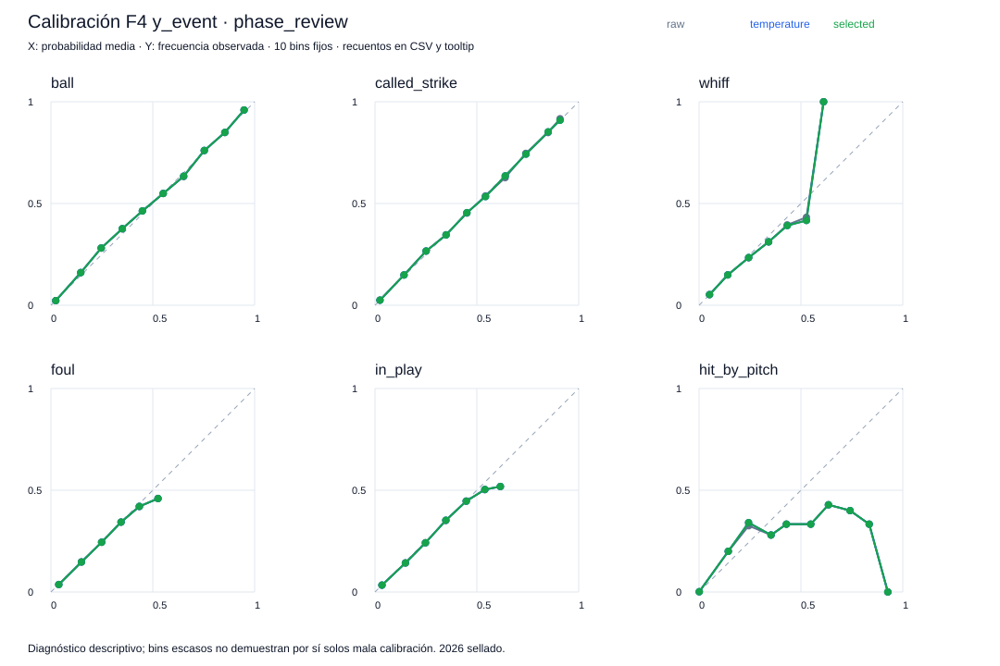
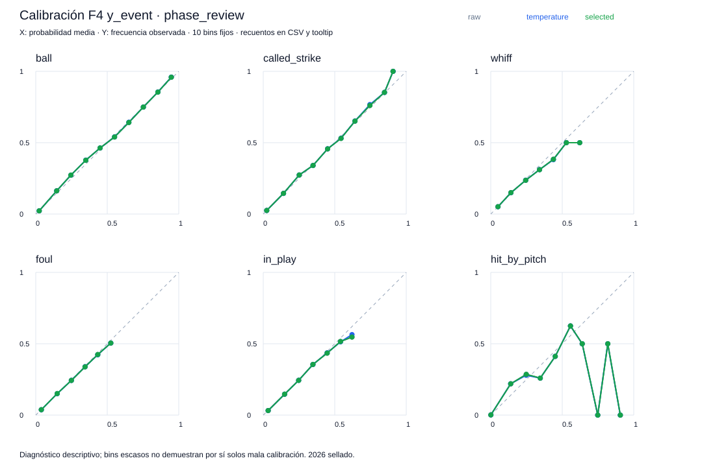
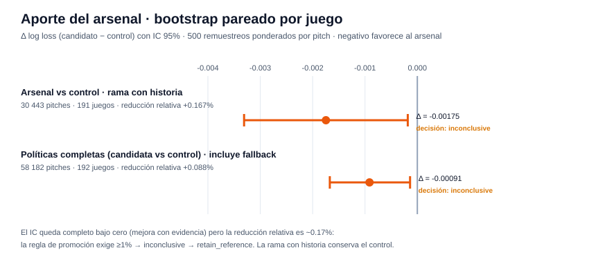
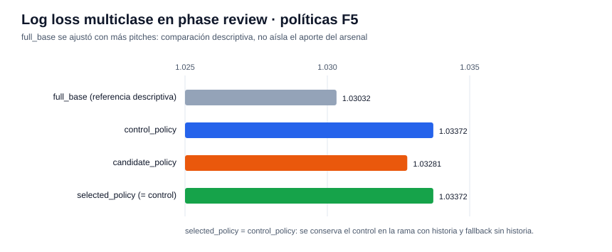

# Reporte de verificación — F5 (arsenal con historia real)

Generado: 2026-10-11 · Experimento: `f5-full-check` · Protocolo C · Seed `20260929` · Data run `e9e0b1114dc68eb2` · Referencia F4: `f4-full-check`

## Resumen ejecutivo

| Verificación | Resultado |
|--------------|-----------|
| Estado de fase | `verified` — 22/22 checks internos |
| Verificación independiente (`check_phase5.py`) | `verified` — 48 hashes de artefactos, **117,549 filas** de predicción y 8 grupos de métricas reproducidos; diferencia máxima **0.0**; referencia 2024 reconstruida desde los datos fijados; temperaturas reajustadas solo con 2025/calibration |
| Decisión científica | **`retain_reference`** — el arsenal mejora con evidencia estadística pero muy por debajo del 1% exigido; la rama con historia conserva el modelo control |

**Lectura central:** F5 responde una pregunta acotada — ¿el repertorio histórico de 2024 aporta información a Pitching? — con una ablación pareada: mismo entrenamiento (development 2025, mismos 70,378 pitches con referencia), mismas variables salvo las cinco de arsenal. El candidato gana con IC 95% completo bajo cero, pero la reducción relativa de log loss es solo **+0.17%**, lejos del umbral de promoción → se conserva el control. Además, casi la mitad de los pitches de 2025 carece de historia utilizable (≥30 fastballs en 2024), lo que limita estructuralmente cualquier ganancia.

---

## Qué se agregó en F5

- **Referencia fija 2024** (`fixed_2024_9709e7eacaa24cc9`, 243,254 pitches): por pitcher, el tipo Four-Seam o Sinker más frecuente con ≥30 observaciones completas de velocidad, IVB, HB y release (empate → alfabético). Se reconstruye **solo con 2024** — nunca se rellena el pasado con el futuro — y solo lee campos físicos, tipo y pitcher, sin outcomes.
- **Cinco variables de arsenal**: uso histórico del tipo, diferencia de velocidad, de IVB, de HB y distancia entre coordenadas de release respecto a la referencia del pitcher. La distancia de release **no es tunneling**.
- **Tres modelos**, una configuración predeclarada (31 hojas · min_data 200 · lr 0.05 · L2 5 · 200 rondas fijas, sin búsqueda ni early stopping):

| Modelo | Ajuste | Variables |
|--------|--------|-----------|
| `control` | development 2025 con referencia (70,378) | Pitching sin ambiente |
| `arsenal` | exactamente los mismos 70,378 pitches | Pitching + 5 variables de arsenal |
| `fallback` | todo development 2025 elegible (134,420) | Pitching sin ambiente |

- **Política de dos ramas**: con historia → control o candidato; sin historia → fallback. Solo se publica la rama candidata si supera ≥1% de reducción relativa + IC 95% < 0. `predict_policy` acepta `cold_start=True` para forzar fallback aun existiendo referencia.
- Calibración por temperatura escalar por modelo, ajustada solo con 2025/calibration sobre la población con referencia; aceptada solo si no empeora revisión (misma regla de F4).

## Cohorte y cobertura de historia

| Partición 2025 | Pitches | Con referencia | Cobertura | Pitchers |
|----------------|--------:|---------------:|----------:|---------:|
| development | 134,420 | 70,378 | 52.36% | 540 |
| calibration | 59,367 | 29,140 | 49.08% | 479 |
| phase_review | 58,182 | 30,443 | 52.32% | 492 |

Cobertura en revisión por categoría de altura (metadato de cobertura, no predictor):

| Categoría | Pitches | Con referencia | Cobertura |
|-----------|--------:|---------------:|----------:|
| Extreme Altitude | 15,400 | 8,598 | 55.83% |
| Medium Altitude | 14,922 | 7,793 | 52.22% |
| No Altitude | 27,860 | 14,052 | 50.44% |

Las particiones se asignan por hash de juego dentro de 2025; los mismos pitchers pueden aparecer en varias. Es un escenario de **adaptación con historia**, no un holdout frío de pitchers (el modo frío se fuerza con `cold_start`).

## Calibración de los tres modelos

| Modelo | Temperatura | Log loss revisión (bruto) | Con temperatura | Ruta aceptada |
|--------|------------:|--------------------------:|----------------:|---------------|
| fallback | 0.982 | 1.03054 | 1.03032 | temperature |
| control | 1.002 | 1.04821319 | 1.04821256 | temperature |
| arsenal | 1.003 | 1.04646659 | (1.04646930) | **identity** |

Las temperaturas de control y arsenal se ajustan solo sobre la población con referencia (29,140 pitches de calibration; métricas de revisión sobre los 30,443 pareados). La de arsenal quedó rechazada: empeoraba la revisión en +2.6e-6, y la regla es de no-empeoramiento estricto.

## Comparación arsenal vs control (bootstrap pareado por juego, 500 remuestreos)

| Comparación | Pitches | Juegos | Δ log loss | IC 95% | Reducción rel. | Decisión |
|-------------|--------:|-------:|-----------:|--------|---------------:|----------|
| Arsenal vs control · rama con historia | 30,443 | 191 | −0.00175 | [−0.00331, −0.00018] | +0.167% | inconclusive |
| Políticas completas (incluye fallback) | 58,182 | 192 | −0.00091 | [−0.00167, −0.00014] | +0.088% | inconclusive |

Ambos intervalos quedan completamente bajo cero: hay evidencia de mejora, pero de una magnitud muy pequeña — el arsenal explica una fracción mínima de la pérdida y no alcanza el 1% que la regla de promoción exige. Mismo patrón que las cabezas `experimental` de F4, pero aquí es la comparación principal.

## Políticas completas en phase review

| Política | n | Log loss | Brier multiclase |
|----------|--:|---------:|-----------------:|
| full_base (descriptiva) | 58,182 | 1.03032 | 0.53307 |
| control_policy | 58,182 | 1.03372 | 0.53451 |
| candidate_policy | 58,182 | 1.03281 | 0.53416 |
| **selected_policy** | 58,182 | 1.03372 | 0.53451 |

`full_base` tiene menor pérdida que ambas políticas de dos ramas, pero se ajustó con más pitches (134k vs 70k) — comparación descriptiva que no aísla el aporte del arsenal. `selected_policy` = `control_policy`: la rama con historia conserva el control y la sin historia usa fallback. La referencia productiva del protocolo A (Pitching de F3 calibrado en F4) **no se reemplaza** — el alcance de la promoción era solo protocolo C.

## Cómo verificar los resultados

1. **Checks**: `artifacts/modeling/f5-full-check/F5/checks.json` — 22 flags en `true` (referencia solo 2024, recargas y refits exactos, IDs de ajuste emparejados control/arsenal, cold start usa base).
2. **Re-verificación independiente**: `.venv/bin/python scripts/check_phase5.py f5-full-check` → `status: verified`, `max_prediction_difference: 0.0`, `reference_rebuilt_from_2024: true`, `test_accessed: false`.
3. **Política**: `policy.json` — `promote_arsenal: false`, `history_branch: control`, `missing_history_branch: fallback`, `protocol_A_replaced: false`.
4. **Temperaturas**: `<modelo>/temperature.json` + `calibration_policy.json` — soporte de ajuste, comparación de revisión y ruta aceptada por modelo.
5. **Referencia**: `reference_2024/manifest.json` + `fastballs.parquet`/`type_counts.parquet`/`pitcher_counts.parquet` con hashes — inspeccionable sin outcomes.
6. **Cobertura**: `coverage_*.csv` — por partición, altura, tipo de pitch, pitcher y estado de historia.
7. **Predicción**: `modeling.arsenal.predict_policy('artifacts/modeling/f5-full-check/F5', entradas, cold_start=...)` — devuelve probabilidades, ruta y advertencia de historia insuficiente.

## Advertencias del contrato

- **2026 sigue sellado** — `test_accessed: false`.
- **La revisión se usa repetidamente** — elige temperatura/identidad y compara políticas; no es un test final independiente.
- **~48% de los pitches de 2025 sin historia** — el resultado dice poco sobre pitchers sin referencia 2024; la ausencia de historia acompaña cualquier interpretación.
- **La evidencia de C no demuestra superioridad frente a A** — entrenan en poblaciones y años distintos; la referencia de A permanece aprobada.
- **La distancia de release no es túnel** — es una variable de arsenal, no una medida de tunneling.
- **Altura es metadato de cobertura**, no predictor ni identificador de estadio.
- No hay scores, xRunValue, efecto causal de arsenal ni simulación ambiental todavía.

## Siguiente paso

**F6 — Ambiente y simulación.** Habilitada; no se inicia automáticamente. La ablación ambiental corresponde a esa fase.

---
*Reportes anteriores: [F0 + F1](REPORTE_F0_F1.md) · [F2](REPORTE_F2.md) · [F3](REPORTE_F3.md) · [F4](REPORTE_F4.md) · Gráficas generadas por `scripts/generar_reporte_f5.py` (las curvas de calibración se copian de los artefactos).*
