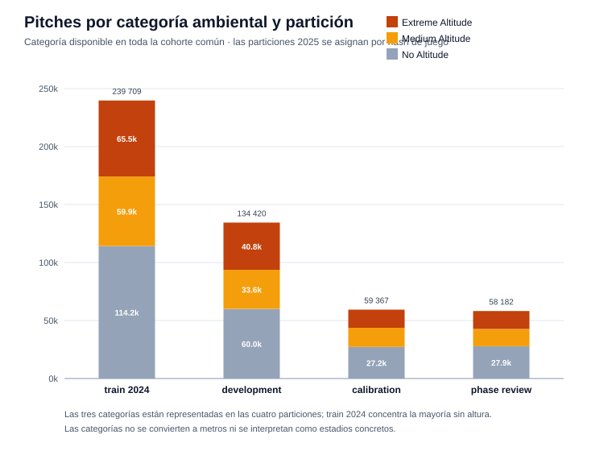
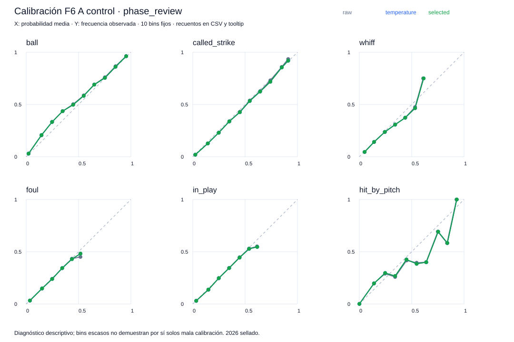
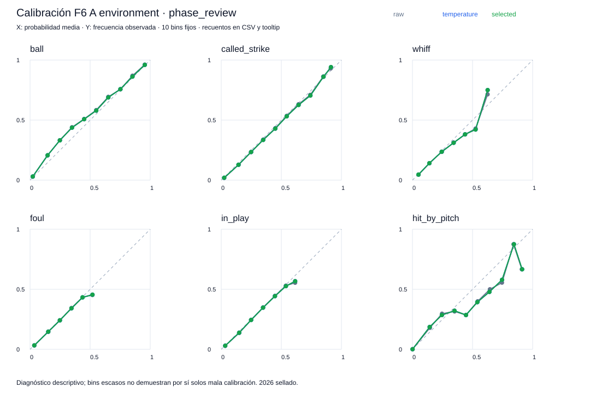
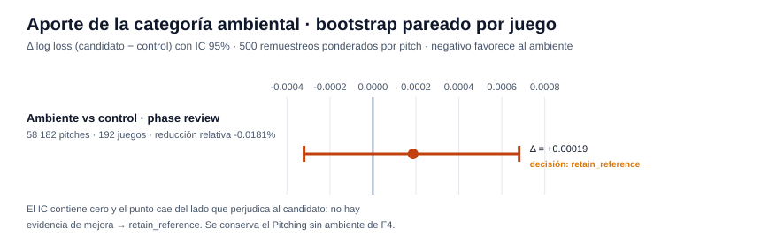
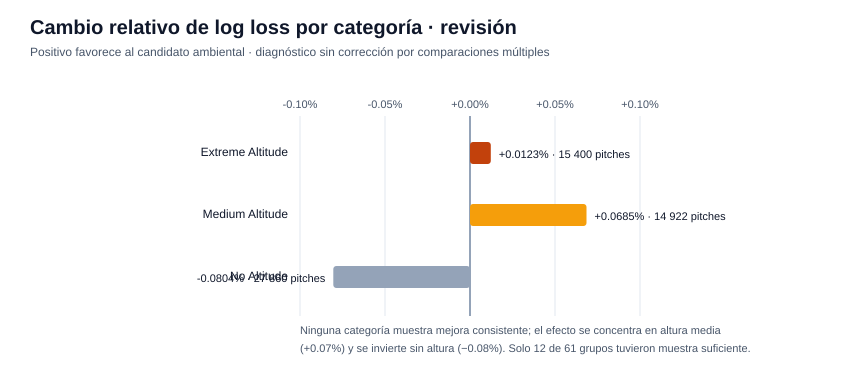
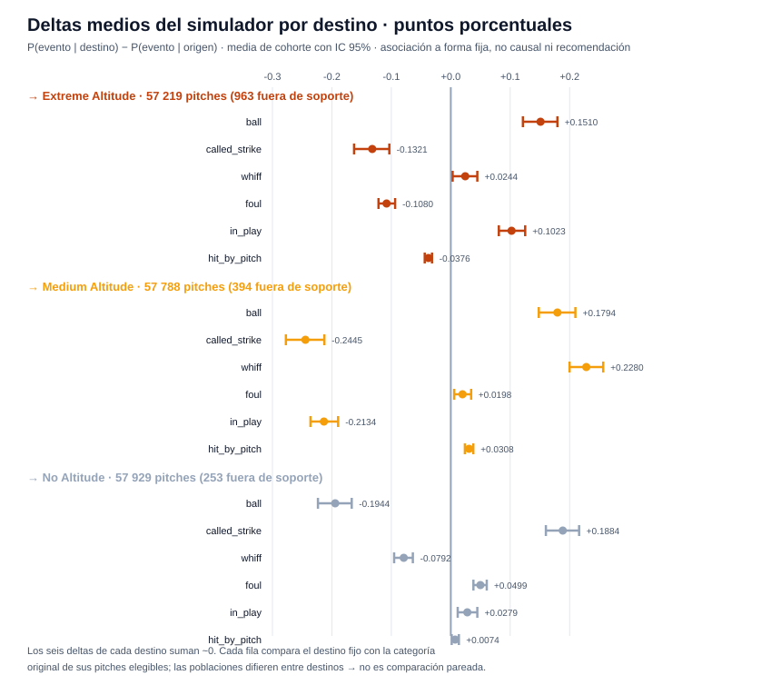

# Reporte de verificación — F6 (ambiente y simulación)

Generado: 2026-10-12 · Experimento: `f6-full-check` · Protocolo A · Seed `20260929` · Data run `e9e0b1114dc68eb2` · Referencias F5: `f5-full-check` / F4: `f4-full-check`

## Resumen ejecutivo

| Verificación | Resultado |
|--------------|-----------|
| Estado de fase | `verified` — 47/47 checks internos |
| Verificación independiente (`check_phase6.py`) | `verified` — 33 hashes de artefactos, **251,969 filas** de predicción y **174,546 filas** de escenario; 6 métricas globales, **61 subgrupos** y 3 intervalos de escenario reproducidos; diferencia máxima **0.0** |
| Decisión científica | **`retain_reference`** — la categoría ambiental no mejora la pérdida; se conserva el Pitching sin ambiente aprobado en F4 |

**Lectura central:** F6 responde si `altitude_category` aporta información a Pitching, con una ablación pareada sobre filas idénticas: mismo entrenamiento 2024, mismas particiones 2025, mismos hiperparámetros congelados del A aprobado — solo cambia una variable. El candidato **empeora** la revisión: Δ log loss **+0.00019** (−0.018% de "reducción"), con IC 95% que contiene cero [−0.00032, +0.00068] → inconclusive → `retain_reference`. El simulador ambiental queda disponible como herramienta **diagnóstica**: sus deltas son asociaciones a forma fija de la cohorte, no mejoras validadas ni efectos causales.

---

## Qué se agregó en F6

- **Ablación pareada control vs candidato** sobre el Pitching del protocolo A: como F5 no promovió arsenal, F6 continúa con la referencia aprobada sin mezclar protocolos. El control se reentrena y en la corrida completa **reproduce exactamente** las probabilidades brutas y calibradas del Pitching de F4 (`control_matches_approved_F4_*`).
- **Una variable nueva**: `altitude_category` (Extreme / Medium / No Altitude). Solo Pitching la recibe; Stuff y Location permanecen invariantes (`stuff_environment_invariant`, `location_environment_invariant`).
- **Configuración congelada**: hiperparámetros del A aprobado de F3 (31 hojas · min_data 200 · lr 0.05 · L2 5), semilla 20260929, presupuesto máximo 400 rondas con parada temprana de 30 en desarrollo. Sin nueva búsqueda.
- **Simulador de asociación** (`fixed_shape_environment_association`): cambia únicamente `altitude_category`, entrega probabilidades origen/destino y deltas de las seis clases, con estado por fila (`ok`, `outside_support`, `unsupported_environment`, `invalid_input`) y `recommendation_allowed=False` siempre.
- **Soporte estimado solo en train 2024**: rangos numéricos por categoría + mínimo 200 observaciones en la combinación categoría/tipo/mano del pitcher/lado del bateador.
- **61 subgrupos diagnósticos** (categoría, tipo de pitch, mano, lado del bateador y combinación triple): métricas solo con ≥200 filas y ≥20 por clase en train y revisión; sin corrección por multiplicidad ni ranking.

## Cohorte y cobertura ambiental

| Partición | Extreme | Medium | No Altitude | Total |
|-----------|--------:|-------:|------------:|------:|
| train 2024 | 65,546 | 59,924 | 114,239 | 239,709 |
| development | 40,752 | 33,642 | 60,026 | 134,420 |
| calibration | 15,603 | 16,552 | 27,212 | 59,367 |
| phase_review | 15,400 | 14,922 | 27,860 | 58,182 |

Las tres categorías están representadas en las cuatro particiones. No se convierten a metros ni se interpretan como estadios concretos; el vocabulario categórico, rangos y soporte se ajustan exclusivamente con train 2024.

## Calibración de los dos modelos

| Modelo | Temperatura | Mejor iteración | Log loss calibración (bruto) | Con temperatura | Ruta aceptada |
|--------|------------:|----------------:|-----------------------------:|----------------:|---------------|
| control | 0.98694197 | 323 / 400 | 1.03273161 | 1.03268406 | temperature |
| environment | 0.98719591 | 337 / 400 | 1.03265443 | 1.03260876 | temperature |

Temperaturas escalares ajustadas solo con 2025/calibration (59,367 pitches), misma regla de no-empeoramiento de revisión que F4/F5.

## Resultados de la ablación

| Modelo / partición | Pitches | Log loss | Brier multiclase |
|--------------------|--------:|---------:|-----------------:|
| control / development | 134,420 | 1.03401471 | 0.53619521 |
| control / calibration | 59,367 | 1.03268406 | 0.53525908 |
| control / phase_review | 58,182 | 1.03235300 | 0.53472264 |
| environment / development | 134,420 | 1.03412888 | 0.53621873 |
| environment / calibration | 59,367 | 1.03260876 | 0.53533960 |
| environment / phase_review | 58,182 | 1.03253997 | 0.53490402 |

Comparación pareada en revisión (bootstrap por juego, 500 remuestreos ponderados por pitch):

| Pitches | Juegos | Δ log loss (cand. − ctrl.) | IC 95% | Reducción rel. | Decisión |
|--------:|-------:|---------------------------:|--------|---------------:|----------|
| 58,182 | 192 | +0.00018697 | [−0.00032030, +0.00068060] | −0.0181% | inconclusive → **retain_reference** |

A diferencia de F5 — donde el IC quedó completo bajo cero pero la magnitud no alcanzó el 1% — aquí el candidato directamente no mejora: el punto estimado cae del lado que favorece al control y el intervalo cruza cero. `policy.json` queda `promote_environment: false`, `prediction_branch: control`, referencia `F4_A_Pitching`.

## Desempeño por subgrupo (diagnóstico)

12 de 61 grupos con muestra suficiente; 49 marcados `insufficient_data` (conservan conteos y cobertura, sin métricas ni ranking). Por categoría ambiental en revisión:

| Categoría | Pitches | Log loss control | Log loss ambiente | Mejora relativa |
|-----------|--------:|-----------------:|------------------:|----------------:|
| Extreme Altitude | 15,400 | 1.05077 | 1.05064 | +0.0123% |
| Medium Altitude | 14,922 | 1.00922 | 1.00853 | +0.0685% |
| No Altitude | 27,860 | 1.03456 | 1.03539 | −0.0804% |

El patrón es inconsistente: ligera mejora en altura media, empeoramiento sin altura. Son diagnósticos sin corrección por comparaciones múltiples y no deciden la promoción global.

## Simulador de escenarios ambientales

El simulador mantiene velocidad, movimiento, release, ubicación, conteo y manos; **solo cambia la categoría** (no se reduce IVB de nuevo). Sobre los 58,182 pitches de revisión:

| Destino fijo | Dentro de soporte (origen y destino) | Excluidos | Juegos |
|--------------|-------------------------------------:|----------:|-------:|
| Extreme Altitude | 57,219 | 963 | 192 |
| Medium Altitude | 57,788 | 394 | 192 |
| No Altitude | 57,929 | 253 | 192 |

Deltas medios de P(in_play) en **puntos porcentuales** con IC 95% del promedio de cohorte:

| Destino | Δ medio | IC 95% |
|---------|--------:|--------|
| Extreme Altitude | +0.10230 | [+0.08093, +0.12517] |
| Medium Altitude | −0.21343 | [−0.23605, −0.18952] |
| No Altitude | +0.02787 | [+0.01171, +0.04459] |

**Límites del simulador:** los deltas son asociaciones de una cohorte con modelo fijo — no incertidumbre individual, no causal, no de reentrenamiento; las poblaciones elegibles difieren entre destinos, así que sus medias no forman una comparación pareada entre categorías. Categorías no vistas (p. ej. «Harp Helú») devuelven `unsupported_environment`; soporte insuficiente o fuera de rango produce `outside_support`. `simulator.predict` entrega las probabilidades del candidato observado, que sigue **experimental**.

## Cómo verificar los resultados

1. **Checks**: `artifacts/modeling/f6-full-check/F6/checks.json` — 47 flags en `true` (recargas y refits exactos, IDs de ajuste/desarrollo emparejados, control reproduce el F4 aprobado, invarianza de Stuff/Location/control a la categoría, delta cero al mismo ambiente, soporte advertido sin recomendación).
2. **Re-verificación independiente**: `.venv/bin/python scripts/check_phase6.py f6-full-check` → `status: verified`, `max_prediction_difference: 0.0`, `test_accessed: false`.
3. **Política**: `policy.json` — `promote_environment: false`, `prediction_branch: control`, `simulator_is_diagnostic: true`, `unsupported_environment_policy: null_with_reason`.
4. **Temperaturas**: `control/` y `environment/` con `temperature.json` + `calibration_policy.json` — soporte de ajuste y ruta aceptada.
5. **Soporte**: `environment_support.json` (rangos por categoría) e `input_support.parquet` (estado por pitch).
6. **Escenarios**: `simulation_deltas.parquet` (174,546 filas) y `simulation_intervals.json` (3 destinos × 6 clases con IC).
7. **Simulación**: `modeling.environment.EnvironmentSimulator.load('artifacts/modeling/f6-full-check/F6')` → `.simulate(entradas, destino)`.

## Advertencias del contrato

- **2026 sigue sellado** — `test_accessed: false`.
- **La revisión se usa repetidamente** — calibra temperaturas y decide la ablación; no es test final independiente.
- **El control se reentrenó** — reproduce exactamente el F4 aprobado en la corrida completa, pero es un ajuste nuevo para comparar sobre filas idénticas.
- **Los subgrupos son diagnósticos** — sin corrección por multiplicidad; 49/61 sin muestra suficiente.
- **El simulador no es causal ni recomendación** — asociación a forma fija; `recommendation_allowed=False`; no hay park holdout ni simulación específica de Harp (faltan estadio, condiciones atmosféricas y altitud numérica).
- **No hay scores todavía** — `score_available: false`; eso corresponde a F7.

## Siguiente paso

**F7 — Scores y agregación.** Habilitada con esta referencia (`f6-full-check`); no se inicia automáticamente. La agregación de scores provisionales corresponde a esa fase. F8 sigue sellando el test 2026 hasta la entrega.

---
*Reportes: [F0 + F1](REPORTE_F0_F1.md) · [F2](REPORTE_F2.md) · [F3](REPORTE_F3.md) · [F4](REPORTE_F4.md) · [F5](REPORTE_F5.md) · Gráficas generadas por `scripts/generar_reporte_f6.py` (las curvas de calibración se copian de los artefactos).*
