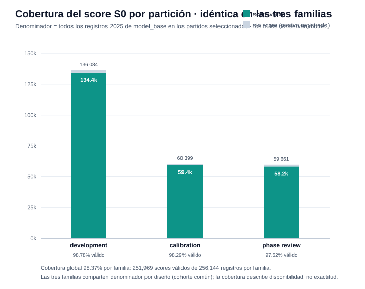
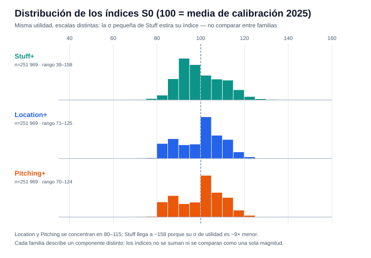
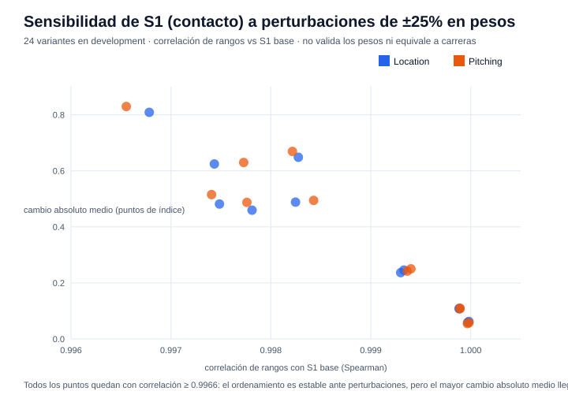
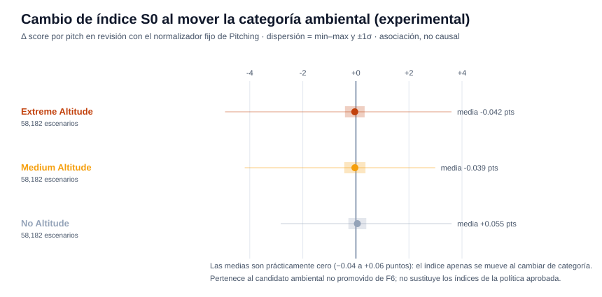

# Reporte de verificación — F7 (índices provisionales y agregación)

Generado: 2026-10-14 · Experimento: `f7-full-check` · Protocolo A · Seed `20260929` · Data run `e9e0b1114dc68eb2` · Referencia F6: `f6-full-check`

## Resumen ejecutivo

| Verificación | Resultado |
|--------------|-----------|
| Estado de fase | `verified` — 25/25 checks internos |
| Verificación independiente (`check_phase7.py`) | `verified` — fórmulas reproducidas sin usar `FixedScale`, referencia de **59,367** pitches recalculada, **768,432 filas** por versión de score, **174,546** escenarios ambientales y **24 variantes** de sensibilidad re-contadas |
| Resultado | Índices **Stuff+ / Location+ / Pitching+ provisionales** publicados con escala fija `100 + 10·(S − μ)/σ` — no hay promoción que decidir: F7 no entrena ni compara modelos |

**Lectura central:** F7 no descubre nada nuevo — convierte las probabilidades calibradas ya aprobadas (Pitching = rama control de F6, que reproduce el F4 aprobado) en índices estilo "plus" comparables entre consultas. 100 es la media de **esta cohorte de calibración 2025**, no de la LMB. La cobertura es 98.37% por familia; los 4,175 registros sin score por familia conservan motivo explícito y nunca se imputan.

---

## Qué se entregó en F7

- **Score publicado `event_utility_proxy_v1` (S0)**: `P(whiff) + P(called_strike) − 0.5·P(ball) − P(hit_by_pitch)`; foul e in_play pesan cero. Pesos fijados por contrato, sin ajuste. Utilidad exploratoria de eventos — no carreras esperadas, ni xRunValue, ni el Stuff+ de FanGraphs.
- **Cinco normalizadores congelados**: S0 para las tres familias y S1 para Location/Pitching, todos con μ y σ poblacional (`ddof=0`) de los mismos 59,367 pitches de calibración 2025 (`reference_id` fijado por hash). La referencia completa se usa incluso en smoke.
- **Score experimental `event_contact_utility_proxy_v1` (S1)**: `S0 + 0.5·P(in_play)·P(weak|in_play) − P(in_play)·P(hard|in_play)` — solo Location y Pitching, cuyas cabezas de contacto sí fueron promovidas en F4. En Stuff devuelve nulo con `verified_contact_head_unavailable`.
- **Agregados por pitcher y pitcher/tipo**: media de la mezcla observada (cada pitch pesa igual), con `n_total`, `n_valid`, `coverage`, probabilidades medias y `score_status` por grupo.
- **Traducción de escenarios F6**: los deltas origen→destino del simulador convertidos a la misma escala S0 de Pitching, marcados como experimentales.

## Cobertura del score

| Partición 2025 | Registros (por familia) | Score válido | Cobertura |
|----------------|------------------------:|-------------:|----------:|
| development | 136,084 | 134,420 | 98.78% |
| calibration | 60,399 | 59,367 | 98.29% |
| phase_review | 59,661 | 58,182 | 97.52% |
| **Total** | **256,144** | **251,969** | **98.37%** |

768,432 filas S0 en total (3 familias × 256,144); 755,907 válidas. Los 12,525 nulos (`invalid_or_missing_event_probabilities`) son los pitches fuera de la cohorte común de predicción — conservan fila y motivo. La cobertura mide disponibilidad bajo la política común, no exactitud predictiva.

## Las cinco escalas fijas

| Familia · versión | μ | σ (`ddof=0`) |
|---|---:|---:|
| Stuff · S0 | 0.071878684271 | 0.039450253261 |
| Location · S0 | 0.088272266905 | 0.353936578046 |
| Pitching · S0 | 0.090860702080 | 0.359943212851 |
| Location · S1 | 0.0701989785 | 0.3404753847 |
| Pitching · S1 | 0.0732925941 | 0.3482494832 |

La σ de Stuff es ~9× menor que la de las otras familias: la misma desviación de utilidad produce saltos de índice mucho mayores (su rango llega a ~38–158 frente a ~70–125 de las demás). Por eso el contrato prohíbe sumar o comparar índices entre familias como si fueran una sola magnitud. Media de referencia 100 y desviación 10 dentro de tolerancia `1e-6`; una σ con `ddof=1` (default de pandas) difiere levemente y no indica fallo.

## Agregados

- **4,713** grupos pitcher × partición × familia (S0): 180 sin predicciones válidas → score nulo con `no_valid_predictions`, nunca 100.
- **23,625** grupos pitcher × tipo × partición × familia: 783 sin cobertura, nulos con motivo.
- Los grupos pequeños conservan su `n` explícito: no se les atribuye estabilidad ni se generan recomendaciones o intervalos individuales.

## Sensibilidad de S1 (experimental)

24 variantes: cada peso no nulo de S1 ±25% por separado, con su propia normalización sobre los mismos IDs de calibración, medidas solo en development.

Correlaciones de rangos vs S1 base entre **0.996553 y 0.999983**; mayor cambio absoluto medio **0.8293 puntos** de índice. El ordenamiento es estable ante esas perturbaciones — pero esto describe robustez del ranking, no valida los pesos ni convierte la utilidad en carreras. No se seleccionó variante ganadora; los resultados S1 viven en archivos separados y no se mezclan con S0.

## Escenarios ambientales en escala de índice (experimental)

Los 174,546 deltas del simulador de F6 convertidos a la escala S0 de Pitching:

| Destino fijo | Δ medio de índice | σ | min – max |
|--------------|------------------:|----:|----------:|
| Extreme Altitude | −0.042 | 0.371 | −4.93 / +3.60 |
| Medium Altitude | −0.039 | 0.399 | −4.19 / +2.99 |
| No Altitude | +0.055 | 0.338 | −2.83 / +3.61 |

En unidades de índice el efecto es ínfimo (medias < 0.06 puntos) — consistente con que el ambiente no aportó mejora predictiva en F6. Pertenecen al candidato no promovido: `score_scope = experimental_environment_candidate_fixed_shape...`, `recommendation_allowed = False`, sin intervalos individuales de score.

## Cómo verificar los resultados

1. **Checks**: `artifacts/modeling/f7-full-check/F7/checks.json` — 25 flags en `true` (referencia fija de calibración, hashes de dependencias F6/F5/F4, IDs únicos, nulos con motivo).
2. **Re-verificación independiente**: `.venv/bin/python scripts/check_phase7.py f7-full-check` → `status: verified`, `test_accessed: false`.
3. **Política**: `policy.json` — `published_score_version: event_utility_proxy_v1`, `provisional: true`, `represents_expected_runs: false`, `release_frozen: false`.
4. **Escalas**: `<familia>_<versión>.json` — μ, σ, pesos y `reference_id` auditable contra `reference_ids.parquet`.
5. **Puntuar un lote**: `FixedScale.load('.../pitching_event_utility_proxy_v1.json').score(lote)` — requiere IDs únicos y las seis columnas `p_*`; nunca reajusta la escala con la consulta.

## Advertencias del contrato

- **2026 sigue sellado** — `test_accessed: false`.
- **Provisional, no release** — `release_frozen: false`; el empaquetado de entrega corresponde a F8.
- **No es valor de carreras** — utilidad exploratoria de eventos con pesos del contrato, no estimación de runs.
- **100 = media de esta cohorte**, no de toda la LMB; sin percentiles ni nivel de reemplazo.
- **Índices entre familias no comparables** — σ muy distintas (Stuff ~0.039 vs ~0.35).
- **La calibración no es validación independiente** — `calibration_is_independent_validation: false`; la revisión ya se usó para decisiones de F4–F6.
- **S1 separado de S0** — experimental; en Stuff siempre nulo por cabeza de contacto no promovida.

## Siguiente paso

**F8 — Evaluación final y entrega.** Ya ejecutada: abrió el test de 2026, congeló el release y produjo la interfaz de inferencia final. Ver [REPORTE_F8.md](REPORTE_F8.md) y la guía operativa `docs/EJECUTAR_F8.md`.

---
*Reportes: [F0 + F1](REPORTE_F0_F1.md) · [F2](REPORTE_F2.md) · [F3](REPORTE_F3.md) · [F4](REPORTE_F4.md) · [F5](REPORTE_F5.md) · [F6](REPORTE_F6.md) · [F8](REPORTE_F8.md) · Gráficas generadas por `scripts/generar_reporte_f7.py`.*
