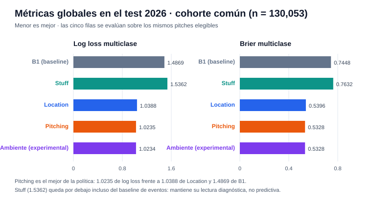
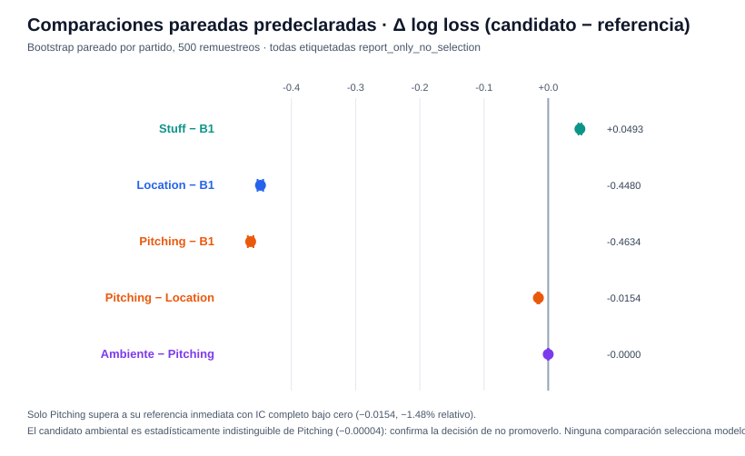
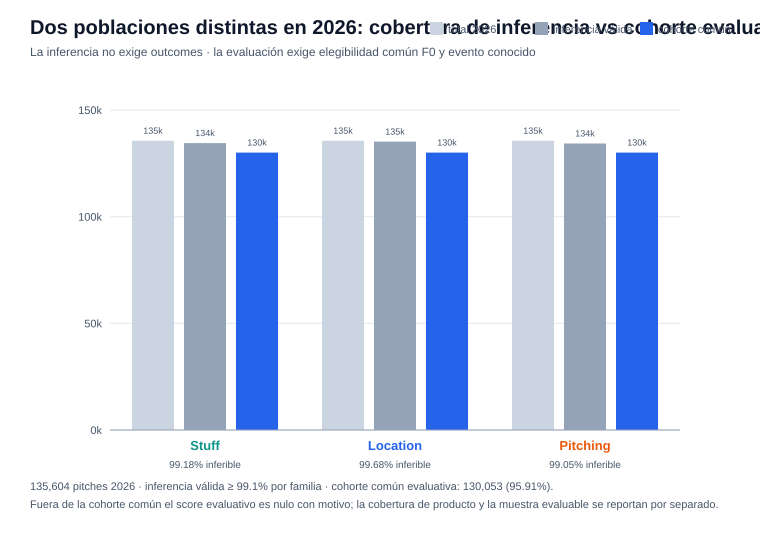
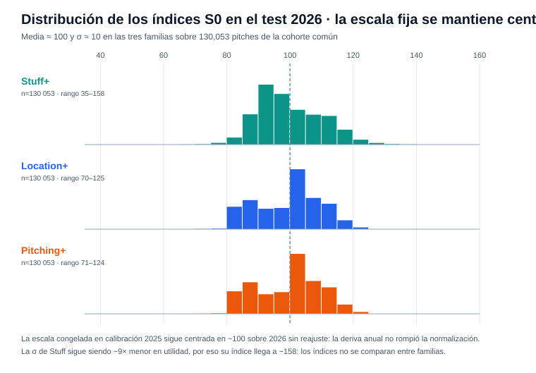
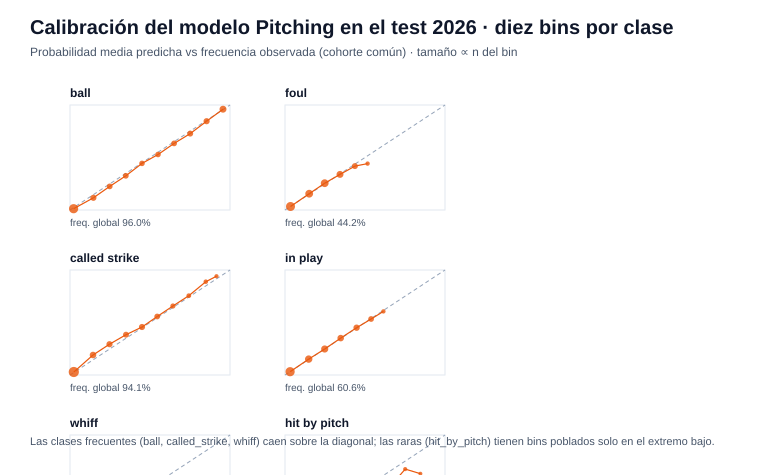
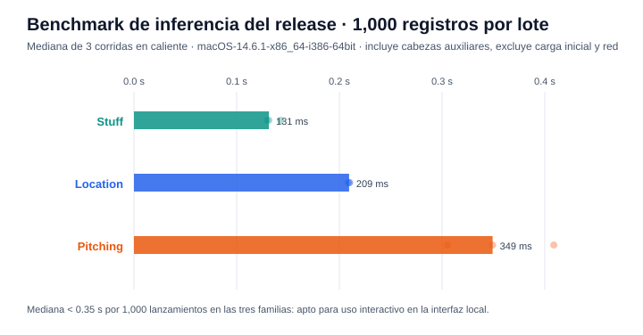

# Reporte de verificación — F8 (release congelado y evaluación final 2026)

Generado: 2026-10-15 · Release: `f8-release-20261014` · release_id `391737796619ef32aa6a3a3d898533dcce86ebf1e0d1d37e83e1d7ccf0a7b3b5` · Protocolo A · Data run `e9e0b1114dc68eb2` · Referencia F7: `f7-full-check`

## Resumen ejecutivo

| Verificación | Resultado |
|--------------|-----------|
| Estado de fase | `verified` — 18/18 pruebas previas sobre 2025 y 7/7 checks finales |
| Verificación independiente (`check_phase8.py`) | `verified` — hashes del lock íntegros, muestra del test re-predicha idéntica, métricas e intervalos recalculados, `dataset_reopened: false` |
| Exposición del test | 2026 abierto **una sola vez**: `test_exposure.json` registrado el 2026-10-15 06:12 UTC con `purpose: final_evaluation` |
| Resultado | Política base confirmada en producción — las cinco comparaciones quedan `report_only_no_selection`: ninguna cambia el release |

**Lectura central:** F8 no descubre ni selecciona — congela la política aprobada de F7 y reporta cómo se comporta en 2026. Pitching sigue siendo el mejor modelo (log loss **1.0235**, −1.48% vs Location con IC95% completo bajo cero); Stuff queda por debajo incluso del baseline de eventos y mantiene su lectura diagnóstica; el candidato ambiental es estadísticamente indistinguible de Pitching, lo que confirma la decisión de F6 de no promoverlo. Las métricas reproducen exactamente las de la corrida oficial documentada en `docs/F8_*` (release `f8-release-20261013`, data run `c1c8ba48818dc878`); lo único distinto es el `release_id`, el hardware del benchmark y la carpeta del release.

---

## Qué se entregó en F8

- **Release inmutable** `artifacts/modeling/releases/f8-release-20261014/`: modelos de eventos y cabezas de F4, calibradores/políticas, los tres normalizadores S0 de F7, B1 de F3, el candidato ambiental de F6, soporte de entrenamiento y `release_lock.json` con hashes de archivos, de todo `modeling/*.py`, de `requirements-modeling.txt` y del dataset.
- **Evaluación final sobre 2026**: 130,053 de 135,604 lanzamientos en la cohorte común F0 con evento conocido — **95.91% de cobertura evaluativa**. Métricas, calibración por clase, comparaciones pareadas (500 remuestreos por partido), subgrupos y agregados.
- **Interfaces de inferencia**: `ReleasePredictor` (Python), modo archivo JSON y servidor local `127.0.0.1:8765` (`/health`, `/schema`, `/predict`) — sin exigir outcomes ni pitcher conocido.
- **Registro de exposición auditable**: `test_exposure.json` + `test_access.jsonl`; una segunda evaluación exige el mismo `release_id` con `--reproduce`.

## Métricas globales en test

| Modelo | Log loss | Brier multiclase |
|--------|---------:|-----------------:|
| B1 (baseline de eventos) | 1.486855 | 0.744793 |
| Stuff | 1.536157 | 0.763166 |
| Location | 1.038812 | 0.539553 |
| **Pitching (política)** | **1.023459** | **0.532800** |
| Ambiente (experimental) | 1.023417 | 0.532822 |

Menor es mejor. El baseline B1 ya es fuerte (mejor que Stuff); la ganancia real de la política viene de las features de ubicación y contexto.

## Comparaciones predeclaradas

| Referencia → Candidato | Δ log loss | IC95% | Lectura |
|------------------------|-----------:|-------|---------|
| B1 → Stuff | +0.049302 | [+0.046981, +0.051505] | Stuff **empeora** al baseline |
| B1 → Location | −0.448043 | [−0.452557, −0.443952] | Mejora grande |
| B1 → Pitching | −0.463396 | [−0.467774, −0.459134] | Mejora grande |
| Location → Pitching | −0.015352 | [−0.016759, −0.014083] | **−1.48% relativo**, IC bajo cero |
| Pitching → Ambiente | −0.000042 | [−0.000410, +0.000289] | Indistinguible de cero |

Todas `report_only_no_selection`: informan, no eligen. El delta ambiental en test (−0.00004) replica la conclusión de desarrollo de F6 — el ambiente no aporta mejora predictiva medible en esta cohorte.

## Cobertura: dos poblaciones diferentes

| Familia | Pitches 2026 | Inferencia válida | Cohorte común evaluativa |
|---------|-------------:|------------------:|-------------------------:|
| Stuff | 135,604 | 134,487 (99.18%) | 130,053 |
| Location | 135,604 | 135,173 (99.68%) | 130,053 |
| Pitching | 135,604 | 134,316 (99.05%) | 130,053 |

La inferencia de producto no exige outcomes: cubre ≥99% de los lanzamientos por familia. El score evaluativo fuera de la cohorte común es nulo con motivo (`outside_common_evaluation_cohort`), nunca imputado.

## La escala fija aguanta 2026

Los índices S0 — normalizados una sola vez sobre calibración 2025 — llegan a 2026 con media ≈ 99.7–99.9 y σ ≈ 10 en las tres familias, sin reajuste. La deriva anual no rompió la normalización.

## Calibración en test

Las clases frecuentes (ball, called_strike, whiff) caen sobre la diagonal en los diez bins; las raras (`hit_by_pitch`) tienen pocos bins poblados — consistente con la calibración por temperatura aprobada en F4 trasladada a un año nuevo sin retoques.

## Subgrupos (Pitching, todos con soporte suficiente)

| Grupo | Valor | n | Log loss |
|-------|-------|--:|---------:|
| Pitcher ausente de entrenamiento 2024 | no | 54,762 | 1.0307 |
| Pitcher ausente de entrenamiento 2024 | **sí** | 75,291 | **1.0182** |
| Pitcher ausente de toda la cohorte 2024–25 | no | 88,395 | 1.0264 |
| Pitcher ausente de toda la cohorte 2024–25 | **sí** | 41,658 | **1.0173** |
| Categoría de altura | Extreme | 42,631 | 1.0102 |
| Categoría de altura | Medium | 27,044 | 1.0117 |
| Categoría de altura | No Altitude | 60,378 | 1.0381 |

Los pitchers nunca vistos rinden *ligeramente mejor* que los conocidos — el modelo base no memoriza al pitcher. Los 35 desgloses (5 modelos × 7 grupos) tienen `descriptive_sufficient`; las métricas son descriptivas, sin intervalos individuales ni lectura causal.

## Cabezas auxiliares

| Familia | Cabeza | Ruta | n válido | Log loss |
|---------|--------|------|---------:|---------:|
| Stuff | contact | `smoothed_training_prevalence` | 23,219 | 1.0506 |
| Stuff | groundball | `model` | 23,437 | 0.6717 |
| Stuff | chase | `smoothed_training_prevalence` | 85,060 | 0.6430 |
| Location / Pitching | contact, groundball, chase | `model` | 23,219 / 23,437 / 85,060 | ver `metrics.json` |

Las rutas de fallback aprobadas en F4 se conservan: en Stuff, contact y chase usan prevalencia de entrenamiento suavizada (la cabeza no fue promovida); el campo `route` de cada salida deja explícito si el número sale de un modelo o de una prevalencia.

## Benchmark local

Medianas en caliente sobre 1,000 registros (3 repeticiones, macOS x86_64, 4 hilos): **Stuff 131 ms**, **Location 209 ms**, **Pitching 349 ms**, incluyendo cabezas auxiliares. La corrida oficial en Windows midió 75/128/151 ms — el orden se conserva; los tiempos absolutos dependen del hardware (`benchmark.json` declara plataforma).

## Casos de scouting

Tres pitchers seleccionados por **mayor volumen de pitches comunes** con desempate por ID — regla fijada antes de abrir test, no por calidad:

| Pitcher | Pitches comunes | ¿Ausente de entrenamiento? | Tipos con más evidencia |
|---------|----------------:|----------------------------|-------------------------|
| `pitcher_00292` | el mayor de la cohorte | no | Four-Seam (249), Sinker (205) |
| `pitcher_00282` | 2.º | sí | Sinker (255), Changeup (178) |
| `pitcher_01112` | 3.º | sí | Sinker (239), Four-Seam (213) |

`scouting_cases.json` conserva la evidencia completa por tipo y familia (18 filas por caso: 6 tipos × 3 familias). Son ejemplos revisables para el informe, no recomendaciones.

## Exposición del test y reproducción

- `artifacts/modeling/test_exposure.json`: `release_id` `3917377…b3b5`, `opened_utc` `2026-10-15T06:12:13Z`, `purpose: final_evaluation`, `data_run` `e9e0b1114dc68eb2`.
- `test_access.jsonl` agrega cada apertura; `evaluate --reproduce` con el mismo `release_id` crea `evaluation_reproduction_<ts>/` sin tocar la original.
- `freeze` quedó bloqueado en esta máquina: no se puede congelar otra política mientras exista el registro. El registro es local — al transportar el release hay que copiar también ambos archivos.
- A partir de aquí, 2026 está expuesto: cualquier desarrollo posterior debe declarar la exposición y no puede presentarse como test independiente.

## Cómo verificar los resultados

1. **Auditoría independiente**: `.venv/bin/python scripts/check_phase8.py artifacts/modeling/releases/f8-release-20261014` → `status: verified`, `dataset_reopened: false`.
2. **Lock**: `release_lock.json` — `verify_release` comprueba archivos, código y dataset antes de cargar o evaluar.
3. **Manifiesto**: `evaluation/manifest.json` — 7 checks finales en `true` (release intacto, solo 2026, filas preservadas, probabilidades finitas, tres casos).
4. **Política**: `policy.json` — `protocol_id: A`, `route: base`, `selection_on_test: false`, `provisional: true`.
5. **Guía operativa**: `docs/EJECUTAR_F8.md` (freeze → smoke → evaluate → check, interfaz local y PDF).

## Advertencias del contrato

- **Provisional** — la utilidad S0 no es valor oficial de carreras ni xRunValue; `represents_expected_runs: false`.
- **Asociación, no causalidad** — el ambiental es diagnóstico; no se promovió y su delta en test es cero dentro del IC.
- **Sin selección en test** — todas las comparaciones `report_only_no_selection`; F5/F6 conservan sus decisiones de desarrollo.
- **2026 ya expuesto** — no reutilizable como test independiente ni para reajustar y re-presentar.
- **Release local ≠ corrida oficial** — la evidencia oficial es `docs/F8_*` con `release_id` `4df11fbf…`; esta corrida la reproduce bit a bit en métricas sobre el data run local `e9e0b1114dc68eb2`.

## Lo que falta

Pendientes que F8 no cierra (detallados en `docs/FASE_8_IMPLEMENTACION.md`, sección de evaluación del hackathon):

- **xRunValue / target oficial**: acordar el target de carreras por conteo y el baseline oficial con ISAC — S0 es utilidad de eventos, no carreras.
- **Mapeo de estadios y bandera Harp**: sigue en `external_requirements_unresolved`; la categoría de altura no equivale a estadio ni a altitud numérica.
- **Holdout por estadio**: existe holdout por pitcher y temporal; falta evaluación con estadios identificados (park holdout).
- **Stuff+**: no supera al baseline de eventos — fortalecerlo o reencuadrar su uso diagnóstico.
- **Validación con usuarios**: evidencia de utilidad del índice en decisiones reales de coach durante la demostración.
- **Limpieza local**: carpeta huérfana `artifacts/modeling/releases/f8-release-20261` (del freeze con nombre truncado); documentos de reportes pendientes de commit.

---
*Reportes: [F0 + F1](REPORTE_F0_F1.md) · [F2](REPORTE_F2.md) · [F3](REPORTE_F3.md) · [F4](REPORTE_F4.md) · [F5](REPORTE_F5.md) · [F6](REPORTE_F6.md) · [F7](REPORTE_F7.md) · Gráficas generadas por `scripts/generar_reporte_f8.py`.*
