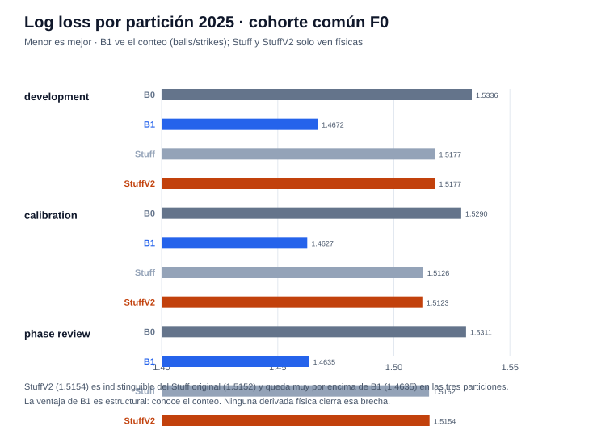
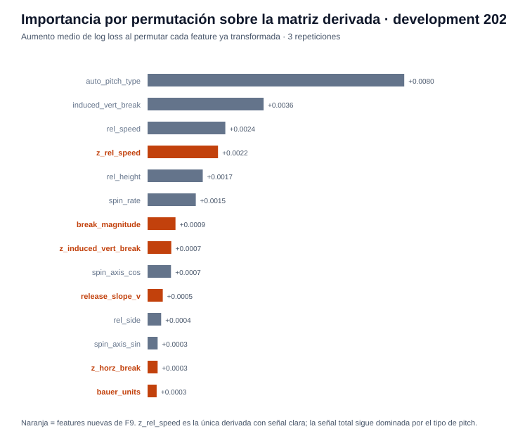

# Reporte de verificación — F9 (StuffV2 post-release, físicas derivadas)

Generado: 2026-10-15 · Experimento: `f9-stuff-v2` · Protocolo A · Seed `20260929` · Data run `e9e0b1114dc68eb2` · Referencias: F1 `f1-full-reproduction`, F2 `f2-full-check`, release `f8-release-20261014` · **Desarrollo posterior a la exposición del test 2026**

## Resumen ejecutivo

| Verificación | Resultado |
|--------------|-----------|
| Estado de fase | `verified` — todos los checks internos en `true` |
| Verificación independiente (`check_phase9.py`) | `verified` — métricas re-contadas desde `predictions.parquet`, bootstrap re-ejecutado, argmin de selección confirmado, `dataset_reopened: false` |
| Test 2026 | **No consultado** — `test_accessed: false`; la exposición de F8 quedó declarada en el manifiesto (`post_release_development: true`) |
| Decisión científica | **`retain_reference`** — StuffV2 no alcanza la regla de promoción frente a B1 |

**Lectura central:** StuffV2 agregó 10 features derivadas (6 deterministas del mismo lanzamiento + 4 z-scores por tipo ajustados solo con train 2024) y una búsqueda completa de 12 configuraciones — y el resultado es **estadísticamente idéntico** al Stuff original (+0.0002 de log loss, IC incluye cero). Sí supera a B0 (−1.6%), pero sigue significativamente **por debajo de B1** (+0.052). La brecha no era de capacidad del modelo: es estructural — B1 conoce el conteo (balls/strikes) y las variables físicas no lo contienen. Esto queda ahora documentado con evidencia, no supuesto.

---

## Qué se entregó en F9

- **Modelo candidato `stuff_v2_derived_physical_v1`** (`postrelease/stuff_v2.py`): STUFF (11 cols) + `bauer_units`, `break_magnitude`, `break_angle`, `axis_angle`, `release_slope_v`, `release_slope_h`, y `z_{rel_speed, spin_rate, induced_vert_break, horz_break}` por `auto_pitch_type`. Las derivadas son deterministas; los z-scores usan medias/σ poblacional (ddof=0) de train 2024 con fallback global para tipos no vistos.
- **Búsqueda completa**: 12 configuraciones predeclaradas (F2 solo probó 3), hasta 800 rondas, selección por log loss en development — `phase_review` nunca se usó para seleccionar.
- **Auditoría propia**: `scripts/check_phase9.py` + 16 pruebas unitarias nuevas (`tests/modeling/test_stuff_v2.py`).
- **Release F8 intacto**: el código nuevo vive en `postrelease/`; `release_lock.json` sigue verificando (`scripts/check_phase8.py` y la API local funcionan).

## Resultados en las tres particiones 2025 (cohorte común F0)

| Modelo | development | calibration | phase_review |
|--------|------------:|------------:|-------------:|
| B0 (global) | 1.5336 | 1.5290 | 1.5311 |
| B1 (conteo + tipo) | **1.4672** | **1.4627** | **1.4635** |
| Stuff (F2 congelado) | 1.5177 | 1.5126 | 1.5152 |
| StuffV2 | 1.5177 | **1.5123** | 1.5154 |



## Comparaciones pareadas en phase_review (500 remuestreos por partido)

| Referencia → StuffV2 | Δ log loss | IC95% | Decisión |
|----------------------|-----------:|-------|----------|
| B0 | −0.015722 | [−0.017050, −0.014375] | **promote** (−1.03% relativo) |
| B1 | +0.051879 | [+0.048839, +0.054730] | inconclusive (peor, no mejor) |
| Stuff (F2) | +0.000198 | [−0.000173, +0.000639] | inconclusive (indistinguible) |


## Selección (development únicamente)

12 configuraciones predeclaradas; todas en el rango 1.5177–1.5216 de log loss.
Ganadora: `candidate_01` (`num_leaves 31, min_data 200, lr 0.05, l2 5.0`,
dev 1.517719, 74 iteraciones). Los modelos más grandes (255–511 hojas) rindieron
peor — señal débil, no falta de capacidad.

## Importancia por permutación (matriz derivada, development)

| Feature | Δ log loss medio |
|---------|-----------------:|
| auto_pitch_type | +0.00797 |
| induced_vert_break | +0.00360 |
| rel_speed | +0.00241 |
| **z_rel_speed** (nueva) | +0.00219 |
| rel_height | +0.00171 |



`z_rel_speed` es la única derivada con señal clara (4.ª de 21). El resto aporta
ruido marginal. La señal disponible en físicas puras está esencialmente agotada
por el conjunto original de F2.

## Qué significa el resultado

- **Para el hackathon**: la brecha crítica de "Calidad de Stuff+" no se cierra
  con más ingeniería sobre las mismas columnas físicas. Las rutas reales son las
  que siguen bloqueadas externamente: target oficial de valor de carreras
  (xRunValue), mapeo de estadios/altitud numérica y secuencia PA.
- **Para el producto**: el Stuff+ provisional conserva su lectura diagnóstica
  (describe calidad física, no predice eventos). No hay cambio al release.
- **Metodológico**: la respuesta honesta a "¿por qué Stuff no mejora?" ya no es
  una hipótesis — hay una corrida verificada que agota el espacio físico
  razonable dentro del presupuesto del contrato.

## Cómo verificar

```bash
.venv/bin/python scripts/check_phase9.py f9-stuff-v2
.venv/bin/python -m unittest tests.modeling.test_stuff_v2 -v   # 16 pruebas
```

Evidencia: `artifacts/modeling/f9-stuff-v2/F9/` — `manifest.json`,
`checks.json` (todos true), `selection.json` (12 trials), `metrics.json`,
`predictions.parquet`, `permutation_importance.json`, `reproducibility.json`,
`calibration_{development,calibration,phase_review}.svg` y `decision.md`.

## Advertencias

- **Post-exposición**: 2026 ya fue abierto por F8 (`test_exposure.json`);
  F9 no lo consultó ni puede presentar phase_review 2025 como test independiente
  (ya informó decisiones F2–F6).
- **No hay segundo release**: aunque hubiera promovido, el release congelado no
  se reabre; haría falta un protocolo nuevo etiquetado.
- **Sin conclusiones causales ni valor de carreras**: mismo alcance que S0.

---
*Reportes: [F0 + F1](REPORTE_F0_F1.md) · [F2](REPORTE_F2.md) · [F3](REPORTE_F3.md) · [F4](REPORTE_F4.md) · [F5](REPORTE_F5.md) · [F6](REPORTE_F6.md) · [F7](REPORTE_F7.md) · [F8](REPORTE_F8.md) · Gráficas generadas por `scripts/generar_reporte_f9.py`.*
